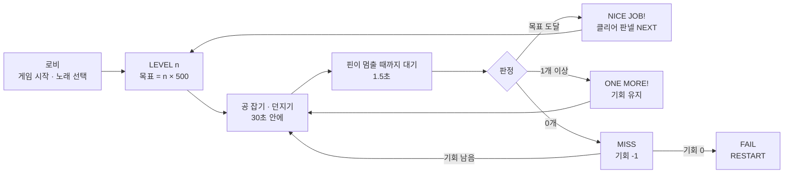

# 01. 게임 컨셉 제안서 — VR Bowling (BowllyBoll)

> 문서 세트: [목차](Proposal.md) · **01 컨셉** · [02 시스템](02_System.md) · [03 투구·개체](03_Combat_Entity.md) · [04 레벨 디자인](04_LevelDesign.md) · [05 밸런스](05_Balance.md) · [시뮬레이션](Simulation.html)

---

## 한 줄 정의 (Elevator Pitch)
> **조명이 음악에 맞춰 깜빡이는 클럽에서, 진짜처럼 공을 잡아 던지며 레벨 목표를 깨는 VR 아케이드 볼링.**

| 항목 | 내용 |
|---|---|
| 장르 | VR 스포츠 · 아케이드 (레벨 클리어형) |
| 플랫폼 | 6DoF VR 헤드셋 (Oculus · Windows MR 설정 포함) |
| 엔진 | Unity 6 · XR Interaction Toolkit 3.x · URP (Bloom) · Floating Text Engine |
| 플레이 시간 | 레벨당 1 ~ 2분, 10레벨 |
| 타깃 유저 | VR 입문자, 친구 · 가족과 번갈아 하는 파티 플레이 |

## 핵심 재미 (Core Fun)
| 키워드 | 무엇이 재미있나 | 코드 근거 |
|---|---|---|
| **물리 손맛** | 잡고 · 휘두르고 · 놓는 팔 동작이 그대로 공의 방향과 세기 | `XRGrabInteractable`, `Ball` |
| **와르르 쾌감** | 핀이 쓰러질 때마다 점수 숫자가 핀 위로 톡 떠오름 + 효과음 | `Pin`, `GameManager`, Floating Text |
| **포기 안 하게 하는 규칙** | 1개라도 쓰러뜨리면 ONE MORE로 기회 +1 (레벨당 3번) | `LevelManager` |
| **클럽 분위기** | 고른 노래의 비트맵에 맞춰 천장 조명이 깜빡임, 형광(Bloom) | `BeatSageLights`, URP |

## 코어 루프


| 루프 | 주기 | 현재 | 💡 제안 |
|---|---|---|---|
| 순간 루프 | 5 ~ 10초 | 던지기 → 핀 쓰러짐 → 점수 | 스트라이크(10핀) 특별 연출 |
| 세션 루프 | 1 ~ 2분 | 레벨 목표 달성 → 다음 레벨 | 목표 곡선 완화 (→ 04) |
| 장기 루프 | 여러 판 | 랭킹(점수 · 레벨) 갱신 | 레벨별 별 3개 평가 |

## 레퍼런스 대비 차별점
| 레퍼런스 (장르) | 가져온 점 | BowllyBoll의 차이 |
|---|---|---|
| 실제 볼링 · VR 볼링 시뮬레이터 | 공을 잡고 던지는 물리 | 10프레임 대신 **레벨 · 목표 점수 · 기회** → 짧고 명확한 목표 |
| VR 리듬 게임 | 음악과 빛의 연출 | 음악은 **분위기**, 게임은 볼링 (리듬을 몰라도 됨) |
| 아케이드 게임 | 단계별 목표 · 결과 판넬 · 랭킹 | 실패해도 ONE MORE로 이어지는 **관대한 규칙** |

## VR 공간 구성
```
            ┌───── 천장 조명 (비트에 맞춰 깜빡) ─────┐
   레인 1      레인 2      레인 3      레인 4        ← 핀 10개 × 4세트
   ▲ ▲ ▲      ▲ ▲ ▲      ▲ ▲ ▲      ▲ ▲ ▲
   │          │          │          │      "5 pin" · 남은 시간
   │          │          │          │
   ═══════════ 파울 라인 ═══════════════
        [공 보관대 소켓]   🥽 플레이어
   (점수판 · 레벨 · 판정 글자 = 헤드셋을 따라오는 캔버스)
```

## 개발 현황
| 구분 | 상태 |
|---|---|
| 구현 완료 | 잡기 · 던지기 · 공 자동 회수 · 핀 쓰러짐 판정 · 레벨 · 기회 · 제한 시간 · 판정 문구 · 결과 / 일시정지 판넬 · 랭킹 · 노래 선택 · 비트 조명 · Bloom |
| 구조 | 제네릭 스포너 `Spawner<T>`, 인터페이스(`ISpawner`, `IReset`, `ITextPopEffect`), 매니저 역할 분리 + 이벤트 연결 |
| 다음 목표 | 목표 곡선 조정 · 투구 수 우회 막기 · 스트라이크 연출 · 음악과 규칙 연결 |
