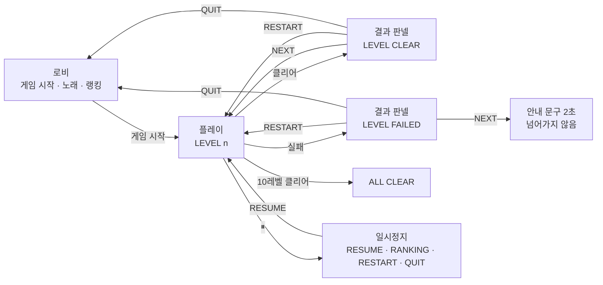
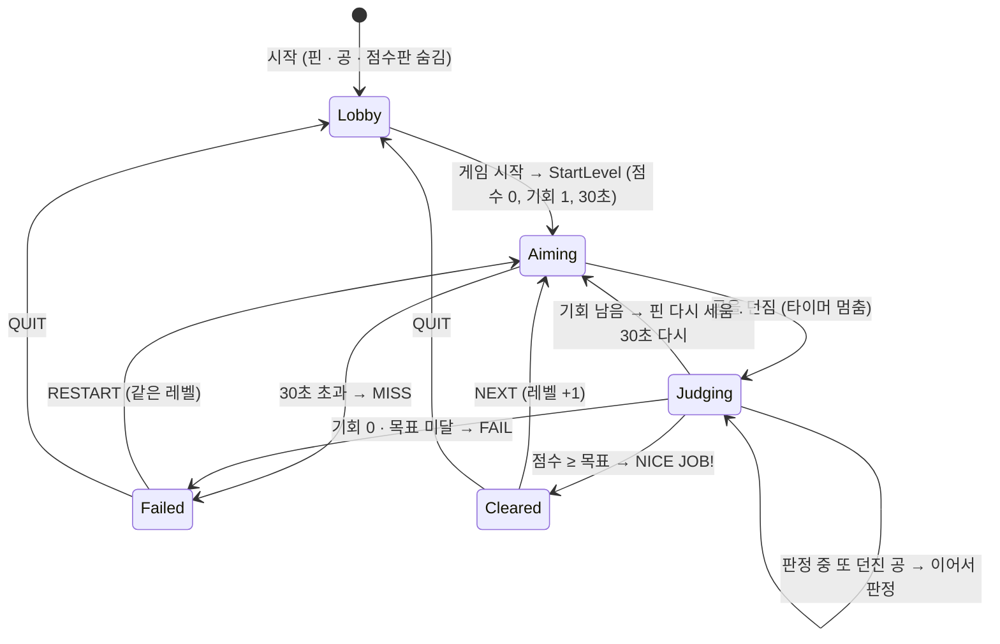

# 02. 시스템 기획서 — 레벨 · 투구 판정 · 공 · 핀 · 랭킹

> 문서 세트: [목차](Proposal.md) · [01 컨셉](01_Concept.md) · **02 시스템** · [03 투구·개체](03_Combat_Entity.md) · [04 레벨 디자인](04_LevelDesign.md) · [05 밸런스](05_Balance.md)
> 관련 코드: `LevelManager.cs` · `GameManager.cs` · `ButtonManager.cs` · `Ball.cs` · `BallSpawner.cs` · `Pin.cs` · `PinSpawner.cs` · `Ranking.cs` · `SoundManager.cs`

---

## 1. 화면 흐름도
씬은 `BowlingGame` 하나. 로비 · 플레이 · 판넬을 **켜고 끄는 방식**으로 전환 (씬을 다시 불러오지 않아 음악 · 조명이 끊기지 않음).


## 2. 레벨 상태 머신 (`LevelManager`)


## 3. 작동 로직
### 3-1. 레벨 시작 `StartLevel()`
```
코루틴 전부 정지 → 판정 · 레벨 종료 플래그 해제 → 대기 중 투구 0
기회 = 1, ONE MORE 사용 = 0, 점수 0
핀 · 공 보이기 → 핀 전부 다시 세우기 (켜진 뒤에 — 순서 중요) → 모든 보관대에 공 새로
"LEVEL n" 팝업 · 목표 글자 갱신 · 핀 개수 "0 pin" → 30초 타이머 시작 (4개 레인 모두에 표시)
```

### 3-2. 투구 판정 `JudgeThrow()`
```
공이 던져짐 (BallThrown)
├─ IF 게임 시작 전 OR 레벨 끝남 → 무시
├─ IF 이미 판정 중 → 대기 투구 +1 (판정이 끝나면 이어서 판정)
└─ ELSE → 판정 시작 (타이머 멈춤)
    ① 대기: 쓰러진 핀 수가 바뀔 때마다 시간 갱신
       ├─ 1개 이상 AND 1.5초 동안 변화 없음 → 결과 확정
       └─ 0개 AND 던진 뒤 8초 경과 → 결과 확정
    ② 가장 많이 쓰러진 레인 기억 (다음 카운트다운은 그 레인에만)
    ③ IF 점수 ≥ 목표 → NICE JOB! → 클리어 (몇 개를 쓰러뜨렸든)
    ④ 기회 -1
       ├─ IF 쓰러진 핀 < 1 → MISS (효과 · 소리)
       ├─ ELSE IF ONE MORE 사용 < 3 → 사용 +1, 기회 +1, ONE MORE! (효과 · 소리)
       └─ ELSE → 문구 없이 진행
    ⑤ IF 기회 ≤ 0 → (MISS가 아니었으면 FAIL 문구) → 실패
       ELSE → 핀 다시 세우기
    ⑥ IF 대기 투구 > 0 → 대기 -1, 다시 판정 / ELSE → 30초 타이머 다시
점수가 목표에 닿았는데 판정 중이 아님 → 즉시 판정 (NICE JOB을 놓치지 않게)
```

### 3-3. 공 (`Ball` · `BallSpawner`)
```
보관대 소켓 4칸에 공 생성 (오브젝트 풀, 프리팹 랜덤)
손으로 잡음 → isHeld (소켓이 잡는 것은 무시)
손에서 놓음
├─ IF 이미 던진 공을 다시 주웠다 놓음 → 회수 시간만 새로 잼
├─ IF 소켓에서 0.5m 안 → 제자리로 되돌림 (던진 것 아님)
└─ ELSE → 던짐 처리 → BallThrown 알림 → 0.5초 뒤 같은 소켓에 새 공
던진 공 (손에 없을 때만 검사)
└─ IF 높이 < -10 OR 소켓에서 30m 이상 OR 놓은 지 30초 → 회수(꺼서 풀에 반납)
바닥(Floor)에 처음 닿음 → 굴러가는 소리 1번
```

### 3-4. 핀 (`Pin`)
```
생성 · 다시 세우기 → 고정(물리 끔, kinematic)
고정 중 매 물리 프레임: 주변(핀 크기 + 0.05m)에
  ├─ 0.2m/s보다 빠른 공 OR 움직이는 핀 → 고정 해제 (물리 켬)
쓰러짐 (1번만)
  ├─ Floor 태그 트리거에 닿음 OR 처음 방향에서 45도 이상 기울어짐
  └─ 핀 소리 · GameManager +100점 · 핀 위에 "+100" 떠오름
```

### 3-5. 랭킹 (`Ranking`)
```
저장 시점: 레벨 클리어 · 실패 · 로비로 나갈 때 · 게임 종료
한 판 = 한 줄 (판 번호 = 시작 시각), 0점은 저장 안 함
정렬: 점수 높은 순 → 같으면 레벨 높은 순, 10줄 보관 · 5줄 표시
저장소: PlayerPrefs에 JSON 문자열
```

### 3-6. 일시정지
```
⏸ → 일시정지 판넬 + timeScale 0 (타이머 · 물리 · 판정 대기 모두 멈춤)
RESUME → timeScale 1 / RESTART · QUIT → timeScale 1로 되돌린 뒤 처리
```

## 4. 예외 처리 (Edge Case)
> ✅ 처리됨 · ⚠️ 문제 · 💡 제안

| # | 상황 | 현재 동작 | 상태 | 처리 방안 |
|---|---|---|---|---|
| 1 | 공을 소켓 바로 옆에 내려놓음 | 0.5m 안이면 제자리 → 던진 것으로 안 셈 (공 5개 생기는 버그 방지) | ✅ | – |
| 2 | 손에 든 공이 멀리 감 | 들고 있는 동안은 회수 안 함 | ✅ | – |
| 3 | 공이 레인 끝에 멈춤 · 밖으로 떨어짐 | 30초 · 30m · 높이 -10으로 회수 | ✅ | – |
| 4 | 시작하자마자 핀이 물리로 흔들려 쓰러짐 | 공이 올 때까지 고정 | ✅ | – |
| 5 | 핀이 쓰러짐 조건 두 개를 동시에 만족 | `isFallen`으로 1번만 점수 | ✅ | – |
| 6 | 판정 중에 또 던진 공 | 대기 투구로 쌓아 이어서 판정 (예전엔 무시해서 게임이 멈췄음) | ✅ | – |
| 7 | **판정 중 연속 투구로 투구 수 우회** | 새 공이 0.5초마다 생겨 판정 중에도 여러 개를 던질 수 있고, 쓰러진 핀은 판정 1번에 합쳐짐 | ⚠️ | 💡 판정 중에는 보관대 소켓을 잠금(잡기 불가) + "판정 중" 표시 |
| 8 | 판정 중 목표 도달 | 즉시 판정 시작 | ✅ | – |
| 9 | **30초 안에 못 던짐** | 남은 기회와 상관없이 MISS → 바로 실패 판넬 | ⚠️ | 💡 기회 -1만 하고 계속 (기회가 0일 때만 실패), 10초 남으면 경고음 |
| 10 | 실패 후 NEXT | 넘어가지 않고 "Current score not reached" 2초 | ✅ | – |
| 11 | 숨긴 상태에서 공이 다시 나타남 | 숨길 때 재생성 예약 취소 | ✅ | – |
| 12 | 일시정지 상태에서 RESTART · QUIT | timeScale 1로 되돌린 뒤 처리 | ✅ | – |
| 13 | 0점 판 | 랭킹에 저장 안 함 | ✅ | – |
| 14 | 사라진 매니저의 이벤트 | `OnDestroy`에서 구독 해제 | ✅ | – |
| 15 | 헤드셋을 벗음 (VR) | 처리 없음 → 타이머 계속 | 💡 | 헤드셋 착용 해제 이벤트에서 자동 일시정지 |
| 16 | 레인 4개 중 아무 데나 침 | 판정은 같고, 판정 후 4세트 모두 다시 세움 | ✅ | 의도된 설계 |
