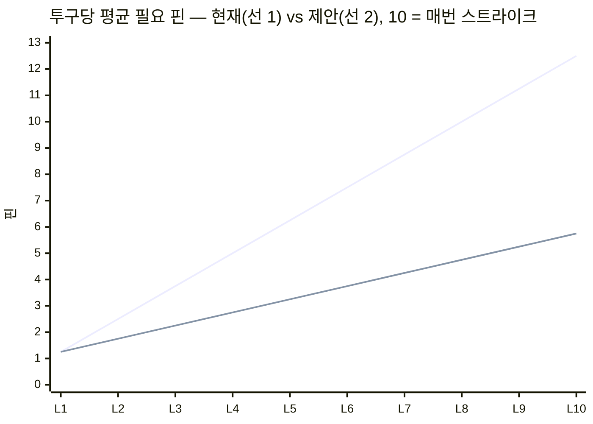

# 04. 레벨 디자인 기획서 — 4레인 볼링장 · 10레벨

> 문서 세트: [목차](Proposal.md) · [01 컨셉](01_Concept.md) · [02 시스템](02_System.md) · [03 투구·개체](03_Combat_Entity.md) · **04 레벨 디자인** · [05 밸런스](05_Balance.md)
> 데이터: [`05_Balance/level_goal.csv`](05_Balance/level_goal.csv)

---

## 1. 스테이지 콘셉트
| 항목 | 내용 |
|---|---|
| 이름 | 네온 볼링 클럽 (`BowlingGame` 씬) |
| 구조 | 나란히 놓인 레인 4개 · 레인당 핀 10개 · 공 보관대 · 천장 조명 |
| 목표 | 레벨마다 목표 점수를 넘겨 10레벨 클리어 |
| 공간 의도 | 레인 4개를 모두 칠 수 있게 해서 **"어느 레인을 노릴까"** 선택지를 줌 |

## 2. 레인 배치 (탑뷰)
```
   레인 1      레인 2      레인 3      레인 4
  ▲▲▲▲        ▲▲▲▲        ▲▲▲▲        ▲▲▲▲     ← 핀 4-3-2-1 삼각형
   ▲▲▲         ▲▲▲         ▲▲▲         ▲▲▲
    ▲▲          ▲▲          ▲▲          ▲▲
     ▲           ▲           ▲           ▲
  "n pin"     "n pin"     "n pin"     "n pin"   ← 레인별 쓰러진 수 · 남은 시간
 │        │ │        │ │        │ │        │
 ══════════════════ 파울 라인 ════════════════
          ◉ ◉ ◉ ◉  공 보관대 (소켓 4칸)
               🥽  플레이어
```
> 도식이에요. 포트폴리오에는 VR 화면 캡처나 씬 뷰 탑다운 캡처를 넣으세요.

## 3. 레벨별 목표 곡선
**현재 (`목표 = 레벨 × 500`, 핀 1개 = 100점, 최대 4투구)**

| 레벨 | 1 | 2 | 3 | 4 | 5 | 6 | 7 | 8 | 9 | 10 |
|---|---|---|---|---|---|---|---|---|---|---|
| 목표 | 500 | 1,000 | 1,500 | 2,000 | 2,500 | 3,000 | 3,500 | 4,000 | 4,500 | 5,000 |
| 필요 핀 | 5 | 10 | 15 | 20 | 25 | 30 | 35 | 40 | 45 | 50 |
| 투구당 평균 필요 | 1.3 | 2.5 | 3.8 | 5.0 | 6.3 | 7.5 | 8.8 | **10.0** | ❌ 11.3 | ❌ 12.5 |
| 체감 | 쉬움 | 쉬움 | 보통 | 보통 | 어려움 | 어려움 | 매우 어려움 | 스트라이크 4연속만 | 불가 | 불가 |

> 1 ~ 4레벨은 금방 지나가고, 7레벨부터 급격히 벽에 막혀요. 8레벨은 4번 모두 스트라이크여야 하고, 9 · 10레벨은 공 하나로는 불가능해요.

**💡 제안 (`목표 = 300 + 레벨 × 200`)**

| 레벨 | 1 | 2 | 3 | 4 | 5 | 6 | 7 | 8 | 9 | 10 |
|---|---|---|---|---|---|---|---|---|---|---|
| 목표 | 500 | 700 | 900 | 1,100 | 1,300 | 1,500 | 1,700 | 1,900 | 2,100 | 2,300 |
| 투구당 평균 필요 | 1.3 | 1.8 | 2.3 | 2.8 | 3.3 | 3.8 | 4.3 | 4.8 | 5.3 | 5.8 |


- 제안 곡선은 **일직선으로 완만하게** 오르고, 10레벨도 "투구당 6핀"이면 클리어 → 입문자도 끝까지 갈 수 있음
- 난이도는 목표 숫자 대신 **레벨 기믹**(아래)으로 올려 지루하지 않게

## 4. 💡 레벨 기믹 제안 (목표 대신 "다르게" 어려워지기)
| 레벨 | 기믹 | 효과 |
|---|---|---|
| 1 ~ 3 | 없음 | 잡기 · 던지기 적응 |
| 4 | 움직이는 핀 세트 | 한 레인의 핀이 좌우로 천천히 이동 |
| 5 | 레인 1개 막힘 | 가운데에 장애물 → 커브 · 다른 레인 선택 |
| 6 | 무거운 공 등장 | 공 무게 선택 시작 |
| 7 | 어두운 레인 | 조명이 박자에 맞춰 켜질 때만 핀이 보임 (음악과 규칙 연결) |
| 8 ~ 9 | 기믹 2개 조합 | |
| 10 | 보스 핀 | 가운데 큰 핀(500점) — 맞히면 나머지가 같이 쓰러짐 |

## 5. 음악 · 조명 배치
| 항목 | 현재 | 💡 제안 |
|---|---|---|
| 노래 선택 | 로비에서 목록 선택, 켜기 / 끄기 | 레벨 7 이후 자동으로 빠른 곡 |
| 천장 조명 | Beat Sage 맵 시간대로 깜빡 (규칙과 무관) | `ON BEAT!` 보너스로 규칙과 연결 |

## 6. 검증 방법
[`Simulation.html`](Simulation.html) 오른쪽 패널에서 "코드: 레벨 × 500" / "제안: 300 + 레벨 × 200"을 바꾸면 표의 빨간 줄(클리어 불가 레벨)이 사라지는 것을 볼 수 있어요.
