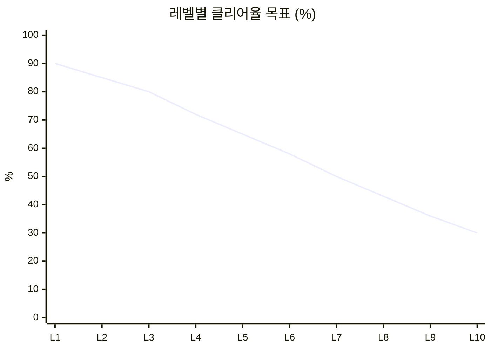

# 로그 · 지표 설계 — VR Bowling (BowllyBoll)

> 문서 세트: [목차](Proposal.md) · 기획: [컨셉](Concept.md) · [시스템](System.md) · [전투·개체](Combat_Entity.md) · [레벨 디자인](LevelDesign.md) · [밸런스](Balance.md) · 사업·운영: [사업 검토](Business.md) · [요구사항·로드맵](Requirements.md) · [BM·경제](Monetization.md) · [서버·데이터](Server_Data.md) · [리소스](Resources.md) · **로그·지표** · [QA·출시](QA_Release.md) · [라이브 운영](LiveOps.md) · [사업화·법무](Business_Legal.md) · [needFix](needFix.md)

> **문서 정보** · ID `D10-LOG` · v1.0 · 상태 `Draft` · Owner ME (기획 · 개발) · 최종 수정 2026-11-21 · 관련 `D01-BIZ`, `D07-BM`

**변경 이력**

| 버전 | 날짜 | 변경 내용 | 사유 | 결정자 | 영향 범위 |
|---|---|---|---|---|---|
| v1.0 | 2026-11-21 | 최초 작성 | 사내 문서 기준 v3 적용 | ME | 문서만 |

---

## 1. 이 문서의 역할
출시 후 **무엇을 측정할지** 정하는 문서예요.
> 지금 구현: 로그 없음. VR에서 쓸 수 있는 도구 선택 → [F-08](needFix.md#8-사내-문서-기준-v3-적용-후-정할-것)

## 2. 이름 규칙
- 이벤트 `evt_대상_동작`, 파라미터 `snake_case`, 공통 `app_version` · `device_model` · `session_id`
- 개인정보 · 머리 · 손 추적 원본 데이터는 넣지 않아요.

## 3. 이벤트 목록
| 이벤트 | 발생 시점 | 파라미터 | 확인할 지표 |
|---|---|---|---|
| `evt_session_start` | 앱 시작 | first_open, seated_mode | 세션 · 앉아서 모드 비율 |
| `evt_level_start` | 레벨 시작 | level, song_id | 레벨별 시도 |
| `evt_throw` | 투구 판정 끝 | level, lane, pins_down, release_speed, strike, spare, one_more | **투구당 평균 핀 수 (S-10)** · 손맛 (S-12) |
| `evt_level_end` | 클리어 · 실패 | level, result, score, goal, stars, fail_reason(score / time), play_sec | 레벨별 클리어율 · 실패 이유 |
| `evt_pause` | 일시정지 | reason(headset_off / menu) | S-03 |
| `evt_song_pick` | 노래 선택 | song_id | 인기 곡 |

## 4. 지표 ↔ 이벤트
| 지표 | 계산 |
|---|---|
| 목표 곡선 검증 | 레벨별 `score ÷ goal` 분포 — 클리어율이 레벨마다 완만히 떨어지는지 |
| 투구당 평균 핀 수 | `evt_throw.pins_down` 평균 → S-04 곡선의 기준점 |
| 실패 이유 | `fail_reason` 비율 — 시간 초과가 많으면 30초가 짧은 것 |

**[선그래프] 레벨별 클리어율 목표 (예시)**

> 읽는 법: 선이 완만하게 내려가면 의도대로예요. 한 레벨에서 갑자기 꺾이면 그 레벨의 목표 점수를 낮춰요.
