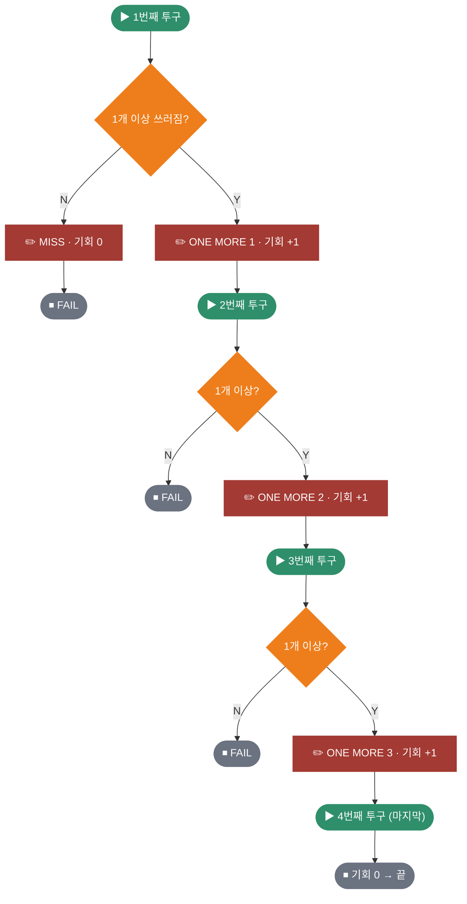
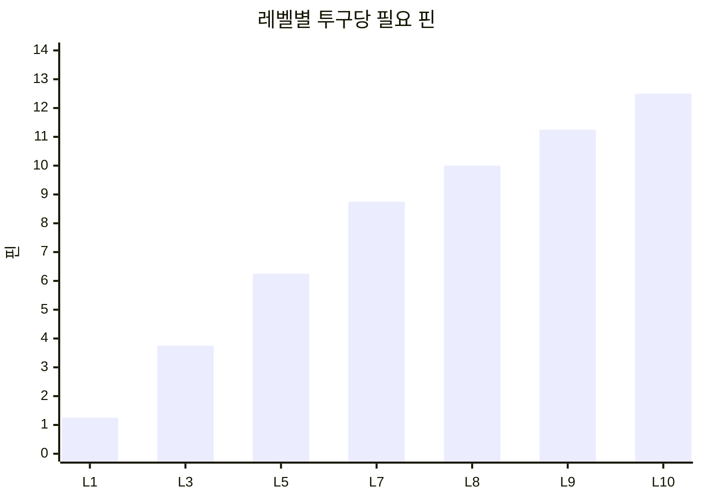

# 밸런스 · 데이터

> 문서 세트: [목차](Proposal.md) · 기획: [컨셉](Concept.md) · [시스템](System.md) · [전투·개체](Combat_Entity.md) · [레벨 디자인](LevelDesign.md) · **밸런스** · 사업·운영: [사업 검토](Business.md) · [요구사항·로드맵](Requirements.md) · [BM·경제](Monetization.md) · [서버·데이터](Server_Data.md) · [리소스](Resources.md) · [로그·지표](Analytics.md) · [QA·출시](QA_Release.md) · [라이브 운영](LiveOps.md) · [사업화·법무](Business_Legal.md) · [needFix](needFix.md)
> 데이터 파일 (JSON · Unity `JsonUtility`로 바로 읽는 구조): [`rule_params.json`](Balance/rule_params.json) · [`level_goal.json`](Balance/level_goal.json)
> 값은 `BowlingGame` 씬 · 프리팹에 저장된 실제 값 기준

> **문서 정보** · ID `D06-BAL` · v1.0 · 상태 `Review` · Owner ME (기획 · 개발) · 최종 수정 2026-11-21 · 관련 `Balance/*.json`, `D07-BM`

**변경 이력**

| 버전 | 날짜 | 변경 내용 | 사유 | 결정자 | 영향 범위 |
|---|---|---|---|---|---|
| v0.9 | 2026-11-20 | 기존 문서 (자세한 기록은 git 커밋) | — | ME | — |
| v1.0 | 2026-11-21 | 문서 정보 · 변경 이력 · 문서 ID 추가, 문서 세트에 사업·운영 문서 연결 | 사내 문서 기준 v3 적용 | ME | 문서만 (게임 코드 · 데이터 변경 없음) |

---

## 1. 규칙 파라미터 (`rule_params.json`)
| 항목 | 값 | 위치 |
|---|---|---|
| 최대 레벨 / 레벨당 목표 증가 / 핀 점수 | 10 / 500 / 100 | `LevelManager`, `GameManager` |
| 시작 기회 / ONE MORE 기회 / 최소 핀 / 레벨당 최대 | 1 / +1 / 1개 / 3번 | `LevelManager` |
| 판정 대기 / MISS 대기 / 던지기 제한 | 1.5초 / 8초 / 30초 | `LevelManager` |
| 쓰러짐 각도 / 고정 해제 거리 / 고정 해제 공 속도 | 45도 / 0.05m / 0.2m/s | `Pin` |
| 새 공 대기 / 던짐 인정 거리 / 회수 시간 | 0.5초 / 0.2m / 30초 | `BallSpawner`, `BALL` 프리팹 |
| 보관대 / 소켓 / 레인 / 레인당 핀 | 3 / 5 / 4 / 10 | 씬 |
| 판정 문구 페이드 / 표시 / 시작 크기 | 0.5초 / 1.5초 / 1.6배 | `ButtonManager` |
| 랭킹 보관 / 표시 | 10 / 5 | `Ranking`, `RankingBoard` |

## 2. 레벨당 최대 투구 수
**[흐름도] 레벨당 최대 투구 수**

> 읽는 법: 초록에서 시작해 내려가요. 1개 이상 쓰러뜨릴 때마다 ONE MORE로 기회가 1번 더 생기고(최대 3번), 그래서 최대 4번 던질 수 있어요. 어느 때든 점수가 목표에 닿으면 바로 클리어예요.

```
최대 투구 = 시작 기회 + ONE MORE 최대 = 1 + 3 = 4
          (ONE MORE를 받으려면 앞의 3번이 모두 1개 이상 맞혀야 함)
최대 점수 = 4 × 10핀 × 100 = 4,000점 (공 하나로 한 레인씩 칠 때)
```

## 3. 목표 점수 (`level_goal.json`)
```
목표(레벨)      = 레벨 × 500
투구당 필요 핀   = 목표 ÷ 100 ÷ 4
```
| 레벨 | 목표 | 필요 핀 | 투구당 필요 핀 | 공 하나로 한 레인씩 가능? |
|---|---|---|---|---|
| 1 | 500 | 5 | 1.25 | O |
| 3 | 1,500 | 15 | 3.75 | O |
| 5 | 2,500 | 25 | 6.25 | O |
| 7 | 3,500 | 35 | 8.75 | O |
| 8 | 4,000 | 40 | 10.00 | O (4투구 모두 스트라이크) |
| 9 | 4,500 | 45 | 11.25 | X |
| 10 | 5,000 | 50 | 12.50 | X |

**[막대그래프] 레벨별 투구당 필요 핀 (4투구 기준)**

> 읽는 법: 10핀 = 매번 스트라이크. L8은 4번 모두 스트라이크, L9 · L10은 10핀을 넘어서 공 하나로는 불가능해요.

## 4. 시간
```
one chance
|<------------- throw limit 30s ------------->|
                       |<- roll ->|<- 1.5s ->|
                     throw                 JUDGE
```
| 구간 | 시간 |
|---|---|
| 던지기 제한 | 기회마다 30초 (판정 중에는 멈춤) |
| 판정 대기 (핀이 멈춘 뒤) | 1.5초 |
| MISS 대기 (하나도 안 쓰러짐) | 8초 |
| 판정 문구 | 페이드 0.5초 · 표시 1.5초 |
