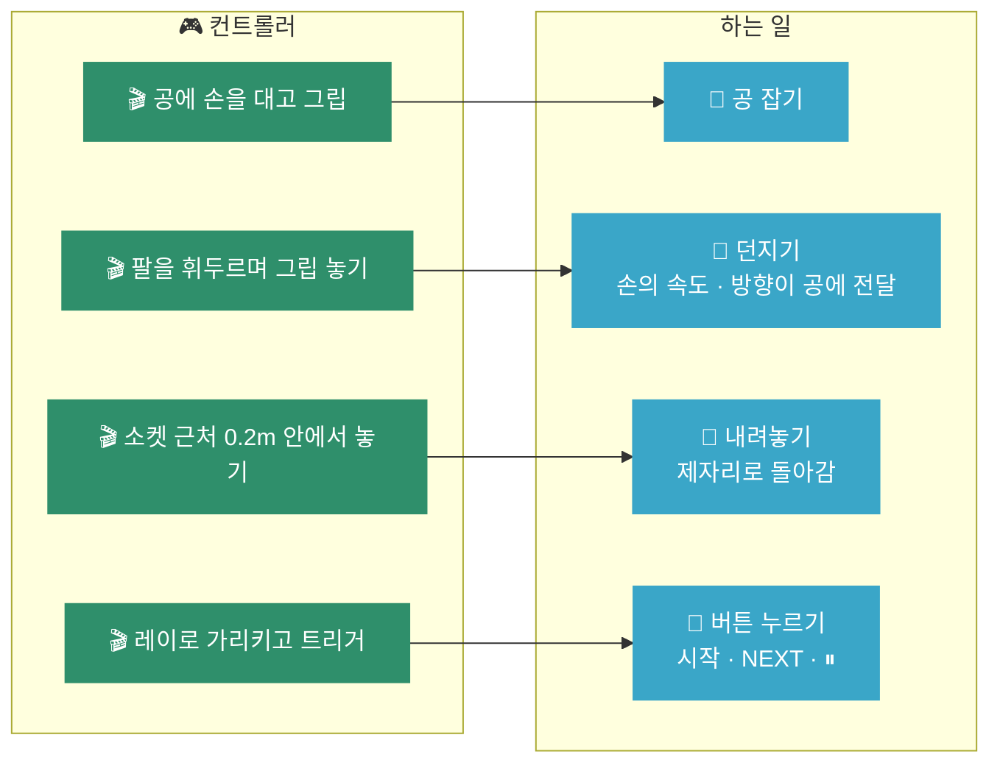
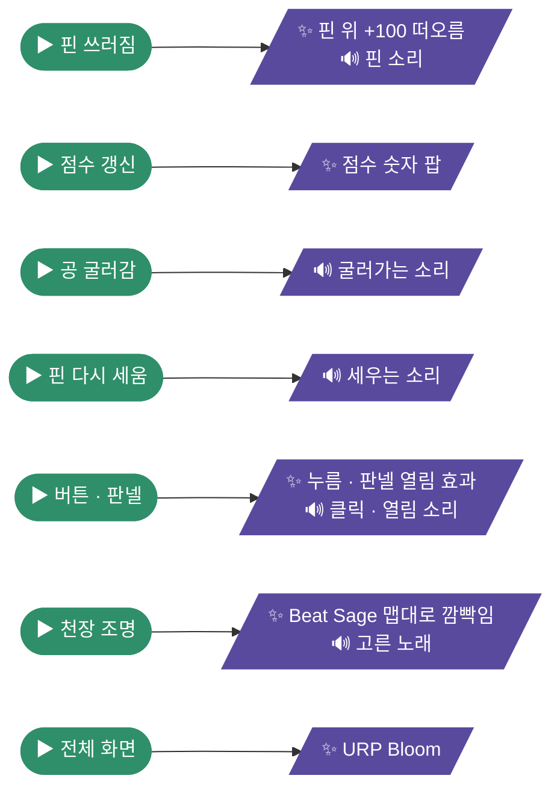

# 투구 · 개체 (공 · 핀 · 판정 연출)

> 문서 세트: [목차](Proposal.md) · [컨셉](Concept.md) · [시스템](System.md) · **투구·개체** · [레벨 디자인](LevelDesign.md) · [밸런스](Balance.md) · [needFix](needFix.md)
> 볼링에는 "전투"가 없어서 이 자리에 핵심 조작(투구)과 상호작용 개체(공 · 핀)를 담았어요. 값은 씬 · 프리팹 기준.

---

## 1. VR 조작
| 동작 | 컨트롤러 | 판정 |
|---|---|---|
| 공 잡기 | 공에 손을 대고 그립 | `XRGrabInteractable` 선택 시작 |
| 던지기 | 팔을 휘두르며 그립 놓기 | 놓는 순간 손의 속도 · 방향이 공에 전달, 소켓에서 0.2m 이상 떨어져야 투구 |
| 내려놓기 | 소켓 근처(0.2m 안)에서 놓기 | 제자리로 돌아감 |
| 버튼 누르기 | 레이로 가리키고 트리거 | 게임 시작 · NEXT · ⏸ 등 |

**[구성도] VR 조작 (손 동작 → 하는 일)**

> 읽는 법: 왼쪽 초록 = 손 동작 → 오른쪽 파랑 = 게임에서 일어나는 일이에요.

## 2. 공 (`Ball`)
| 항목 | 값 | 근거 |
|---|---|---|
| 물리 | Rigidbody + XR 잡기, 놓을 때 손 속도 그대로 | `Ball` |
| 종류 | 프리팹 5종 (`BALL`, `BALL (1)` ~ `(4)`) 중 랜덤 | `BallSpawner.prefabs` |
| 보관대 | 3개 × 소켓 5칸, 던지면 0.5초 뒤 같은 칸에 새 공 | 씬 |
| 던짐 인정 | 소켓에서 0.2m 밖에서 놓음 | 프리팹 값 (코드 기본값 0.5) |
| 회수 | 놓은 뒤 30초 / 소켓에서 30m / 높이 -10 아래 | 프리팹 |
| 소리 | 던진 뒤 바닥에 처음 닿을 때 굴러가는 소리 1번 | `Ball.OnCollisionEnter` |

## 3. 핀 (`Pin`)
```
레인 하나 (위에서 본 모습, 번호 = 핀 번호)
   7   8   9   10
     4   5   6
       2   3
         1
         ^
         O  공

레인 3개 x 핀 10개 = 30개 (켜진 PinSpawner 3개), PinSpawner가 바닥 면에 맞춰 생성
```
| 항목 | 값 |
|---|---|
| 대기 상태 | 고정(kinematic) — 0.2m/s보다 빠른 공이나 움직이는 핀이 핀 크기 + 0.05m 안에 오면 물리 켬 |
| 쓰러짐 판정 | Floor 태그에 닿음 또는 45도 이상 기울어짐 |
| 점수 | 쓰러질 때 +100 (1번만) |
| 다시 세우기 | 처음 자리 · 방향으로 되돌리고 다시 고정, 세우는 소리 |

## 4. 판정 문구
**문구 등장 애니메이션 (`ButtonManager`)**
```
size
1.6x |*
     | *
     |  *
1.0x |   ************......
     +--------------------------> time
      pop        hold   fade

1.6배로 톡 튀어나와 1배로 줄어든 뒤 표시 · 페이드 0.5초 · 표시 1.5초 + 문구별 소리
```
| 문구 | 조건 | 소리 | 이펙트 |
|---|---|---|---|
| `LEVEL n` | 레벨 시작 | – | – |
| `ONE MORE!` | 1개 이상 · 목표 전 · 레벨당 3번까지 | ONE MORE 소리 | 맞힌 레인 위 파티클 |
| `MISS` | 0개, 또는 30초 초과 | MISS 소리 | 맞힌 레인 위 파티클 |
| `NICE JOB!` | 목표 점수 도달 | NICE JOB 소리 | – |
| `FAIL` | 기회 0 · 목표 미달 (마지막이 MISS면 생략) | FAIL 소리 | – |
| `n pin` | 레인마다 쓰러진 개수 | – | – |
| 남은 시간 | 맞힌 레인에만 (처음엔 4개 모두) | – | – |

## 5. 이펙트 · 사운드 · 조명
**[흐름도] 이펙트 · 사운드 · 조명 (일이 생기면 → 보이고 들리는 것)**

> 읽는 법: 초록 = 이런 일이 생기면 → 보라 = ✨ 보이는 것 · 🔊 들리는 것이에요.

| 대상 | 이펙트 | 사운드 |
|---|---|---|
| 핀 쓰러짐 | 핀 위 "+100" 떠오름 (Floating Text) | 핀 소리 |
| 점수 갱신 | 점수 숫자 팝 | – |
| 공 굴러감 | – | 굴러가는 소리 |
| 핀 다시 세움 | – | 세우는 소리 |
| 버튼 · 판넬 | 누름 효과 · 판넬 열림 효과 | 클릭 · 열림 소리 |
| 천장 조명 | Beat Sage 맵대로 깜빡임 (꺼짐 밝기 0.1 · 켜질 확률 0.5) | 고른 노래 |
| 전체 화면 | URP Bloom | – |
