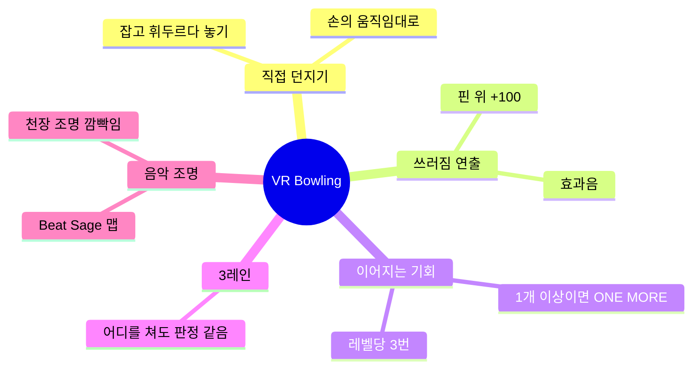
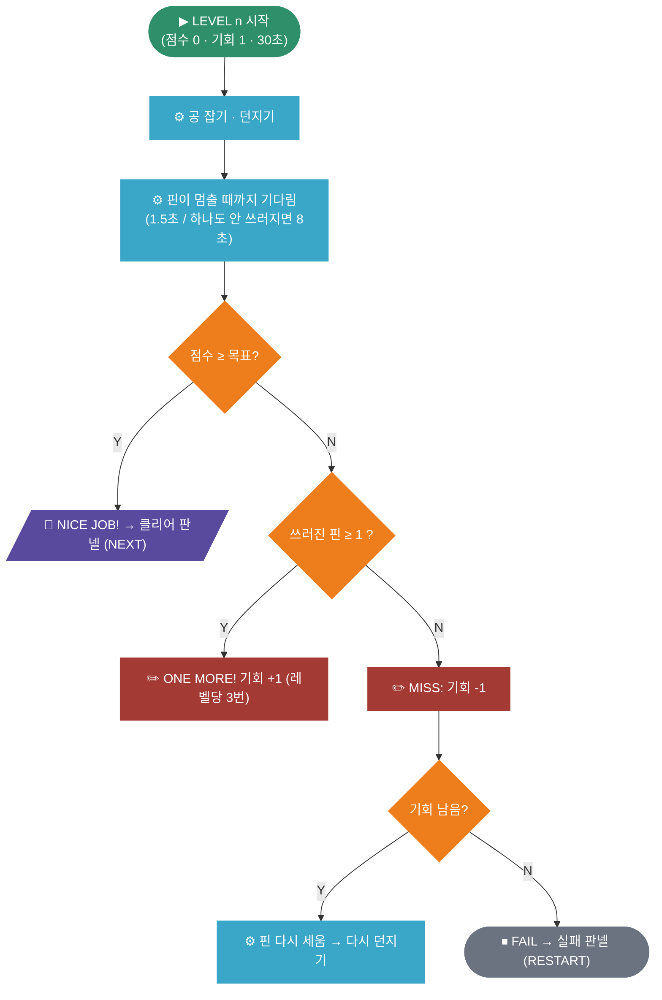

# 게임 컨셉 — VR Bowling (BowllyBoll)

> 문서 세트: [목차](Proposal.md) · 기획: **컨셉** · [시스템](System.md) · [전투·개체](Combat_Entity.md) · [레벨 디자인](LevelDesign.md) · [밸런스](Balance.md) · 사업·운영: [사업 검토](Business.md) · [요구사항·로드맵](Requirements.md) · [BM·경제](Monetization.md) · [서버·데이터](Server_Data.md) · [리소스](Resources.md) · [로그·지표](Analytics.md) · [QA·출시](QA_Release.md) · [라이브 운영](LiveOps.md) · [사업화·법무](Business_Legal.md) · [needFix](needFix.md)

> **문서 정보** · ID `D01-CONCEPT` · v1.0 · 상태 `Review` · Owner ME (기획 · 개발) · 최종 수정 2026-11-21 · 관련 `D01-BIZ`, `D02-REQ`

**변경 이력**

| 버전 | 날짜 | 변경 내용 | 사유 | 결정자 | 영향 범위 |
|---|---|---|---|---|---|
| v0.9 | 2026-11-20 | 기존 문서 (자세한 기록은 git 커밋) | — | ME | — |
| v1.0 | 2026-11-21 | 문서 정보 · 변경 이력 · 문서 ID 추가, 문서 세트에 사업·운영 문서 연결 | 사내 문서 기준 v3 적용 | ME | 문서만 (게임 코드 · 데이터 변경 없음) |

---

## 기획 의도
> 기획자가 정한 방향이에요. 아래 "개요"부터는 지금 코드 · 씬에 구현된 내용이에요.

| 항목 | 내용 |
|---|---|
| 한 줄 정의 | 손으로 잡고 휘둘러 던지는 VR 볼링으로, 레벨마다 목표 점수를 넘겨 10레벨을 깨는 게임 |
| 기획 의도 (핵심 재미) | 내 팔 움직임 그대로 공이 나가는 물리 손맛, 1개라도 쓰러뜨리면 ONE MORE로 기회가 늘어 실패가 부드러움 |
| 타깃 | 볼링 규칙을 몰라도 바로 즐기는 VR 입문자 |
| 플랫폼 · 제약 | VR 헤드셋 + 컨트롤러 2개, 서서 팔을 휘두를 공간 필요 |
| 레퍼런스 · 차별점 | 모션 볼링(Wii Sports 류) · VR 스포츠 → **레벨 목표 점수 도전 + 고른 노래에 맞춰 깜빡이는 조명** |

## 개요
| 항목 | 내용 | 근거 |
|---|---|---|
| 장르 | VR 볼링 · 레벨 클리어형 (목표 점수 · 기회 · 제한 시간) | `LevelManager` |
| 플랫폼 | 6DoF VR 헤드셋 (Oculus · Windows MR 설정) | `EditorBuildSettings` XR 설정 |
| 엔진 · 패키지 | Unity 6 (6000.3.26f1) · XR Interaction Toolkit 3.x · URP (Bloom) · Floating Text Engine Lite | `ProjectSettings`, `Assets/` |
| 씬 | `BowlingGame` 하나 (로비 · 플레이 · 판넬을 켜고 끄는 방식) | 빌드 설정, `LevelManager` |
| 이름 | BowllyBoll | `docs/00_README.md` |

## 재미 요소 (코드에서 확인되는 것)
| 요소 | 내용 | 근거 |
|---|---|---|
| 직접 던지기 | 잡고 휘두르다 놓으면 손의 움직임대로 공이 나감 | `XRGrabInteractable`, `Ball` |
| 쓰러짐 연출 | 핀이 쓰러질 때마다 핀 위에 점수 숫자가 떠오름 + 효과음 | `Pin`, `GameManager`, Floating Text |
| 이어지는 기회 | 1개라도 쓰러뜨리면 ONE MORE로 기회 +1 (레벨당 3번) | `LevelManager` |
| 3레인 | 켜진 레인 3개 중 어디를 쳐도 판정이 같음 | `PinSpawner` 3개 켜짐 (`핀 (3)`은 씬에서 꺼짐) |
| 음악 조명 | 고른 노래의 Beat Sage 맵대로 천장 조명이 깜빡임 | `BeatSageLights`, `SongListUI` |

**투구 동작 (옆에서 본 모습)**
```
(1) grab           (2) swing back       (3) swing + release
      o                  o                    o
     /|--O              /|                   /|\
     / \             O-/ \                   / \   O ---->

(1) 그립으로 잡기 · (2) 뒤로 스윙 · (3) 앞으로 휘두르며 그립 놓기
놓는 순간 손의 속도와 방향이 그대로 공에 전달 (XR Grab)
```

**[마인드맵] 재미 요소 한눈에**

> 읽는 법: 가운데 = 게임, 가지 = 재미 요소, 끝 = 근거가 되는 수치예요.

## 코어 루프

**[흐름도] 한 레벨의 흐름**

> 읽는 법: 초록에서 시작해 화살표를 따라 내려가요. 주황 마름모에서 Y(예) / N(아니오)으로 갈라져요.

## VR 구성
| 항목 | 내용 | 근거 |
|---|---|---|
| 레인 | 3개 × 핀 10개 | `PinSpawner` 4개 중 3개 켜짐, 각 `spawnPoints` 10개 |
| 공 보관대 | 3개 × 소켓 5칸 | `BallSpawner` 3개, 각 `sockets` 5개 |
| UI | 점수판 · 레벨 · 판정 글자 캔버스 | `ButtonManager`, `GameManager` |
| 이동 | 텔레포트 관련 컴포넌트 있음, 연속 이동 컴포넌트 없음 | `BowlingGame.unity` |
| 조명 · 화면 | 천장 조명(Beat Sage 맵), URP Bloom | `BeatSageLights`, `docs/06_Bloom_형광효과.md` |

> 실제 공간 배치는 VR 화면 · 씬 캡처로 넣어 주세요 → [S-08](needFix.md)

## 개발 현황
| 구분 | 내용 |
|---|---|
| 구현됨 | 잡기 · 던지기 · 공 자동 회수 · 핀 고정 / 쓰러짐 판정 · 레벨 · 기회 · 제한 시간 · 판정 문구 · 결과 / 일시정지 판넬 · 랭킹 · 노래 선택 · 비트 조명 · Bloom |
| 구조 | 제네릭 스포너 `Spawner<T>`, 인터페이스(`ISpawner`, `IReset`, `ITextPopEffect`), 매니저 역할 분리 + 이벤트 연결 |
| 다음 할 일 | [needFix](needFix.md) |
