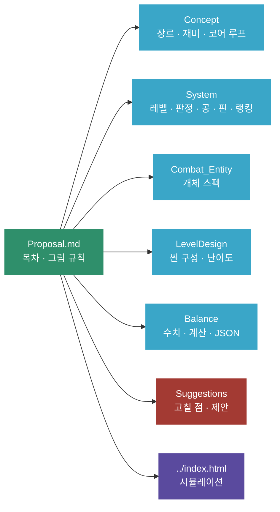

# VR Bowling (BowllyBoll) — 기획서 목차

> **분류:** VR 게임 (6DoF 헤드셋, Oculus · Windows MR 설정) · **장르:** 레벨제 아케이드 볼링 + 음악 조명
> **엔진:** Unity 6 (6000.3.26f1) · C# · XR Interaction Toolkit 3.x · URP
> VR 컨트롤러로 공을 잡고 던져 30초 안에 핀을 쓰러뜨리고, 레벨마다 높아지는 목표 점수를 넘기는 볼링 게임.

---

## 문서 구성
컨셉 ~ 밸런스 문서는 **지금 프로젝트에 구현된 내용**(코드 · 씬 · 프리팹)과 그 값으로 계산한 것만 담았어요. 단, 컨셉의 **기획 의도**는 기획자가 정한 방향이에요.
고쳐야 할 점 · 부족한 점 · 제안 · 정해야 할 항목은 모두 **Suggestions**에 있어요.
구현 방법 설명은 `docs/00 ~ 07`, 이 폴더는 기획 관점 문서예요.

**[구성도] 문서 지도**

> 읽는 법: 왼쪽 목차에서 오른쪽 문서로 이어져요. 빨강 = 고칠 점 · 제안, 보라 = 시뮬레이션이에요.

| 문서 | 주로 보는 사람 |
|---|---|
| [게임 컨셉](Concept.md) | 모두 |
| [시스템](System.md) | 개발 |
| [투구 · 개체](Combat_Entity.md) | 개발 · 아트 |
| [레벨 디자인](LevelDesign.md) | 기획 · 개발 |
| [밸런스 · 데이터](Balance.md) · [JSON](Balance/) | 기획 · 개발 |
| [Suggestions](Suggestions.md) | 모두 |
| [시뮬레이션](../index.html) | 모두 |

---

## 그림 규칙
이 폴더의 모든 그림은 아래 규칙을 따라요. 그림 위의 `[종류]`를 보면 무엇을 설명하는 그림인지 바로 알 수 있어요.

| 그림 | 답하는 질문 | 모양 |
|---|---|---|
| **[흐름도]** | 어떤 **순서**로 일어나나? | 위 → 아래, 색깔 도형 |
| **[구성도]** | 무엇이 무엇과 **연결**되나? 누가 누구에게 **알리나**? | 왼쪽 → 오른쪽 상자, 화살표에 이름 |
| **[구성도] 예외 처리 지도** | 이런 상황이면 **어떻게 되나**? | 주황 상황 → 초록 ✅ 처리됨 / 빨강 ⚠️ 문제 / 회색 💡 개선 |
| **[와이어프레임]** | 화면 **어디에 무엇이** 있나? | 글자 그림 + 위치 표 (씬 RectTransform 값) |
| **[도면]** | 공간에서 **무엇이 어디에** 있나? | 위에서 본 글자 그림 + 좌표 표 (씬 값) |
| **[상태도]** | 지금 어떤 **상태**이고 언제 **바뀌나**? (화면 전환 포함) | 상태 상자, 바뀌는 조건 화살표 |
| **[막대그래프]** | 숫자가 **얼마나** 다른가? | 막대 한 종류 |
| **[원그래프]** | 전체 중 **몇 %**인가? | 원 조각 |
| **[마인드맵]** | 핵심을 **한눈에** | 가운데 → 가지 |
| **[타임라인]** | **언제 · 얼마 동안** 일어나나? | 왼쪽 → 오른쪽 시간 막대 · 마름모 |
| **[선그래프]** | 시간에 따라 값이 **어떻게 변하나**? (궤적 · 누적) | 선 하나 |
| 글자 그림 (코드 블록) | **위치 · 모양** (옆 · 위에서 본 모습, 궤적, 시간 막대) | 글자 · 기호 |
| 표 | 정확한 숫자, **현재 vs 제안** 비교 | 표 |

**흐름도 색**

| 색 · 모양 | 뜻 |
|---|---|
| 초록 둥근 상자 | 시작 · 입력 |
| 파랑 상자 | 처리 |
| 빨강 상자 | 값 변경 (점수 · 횟수 · 상태) |
| 주황 마름모 | 판단 (Y 예 / N 아니오) |
| 보라 평행사변형 | 출력 (소리 · 화면 · 팝업) |
| 회색 둥근 상자 | 끝 · 무시 |

**상태도 색**

| 색 | 뜻 |
|---|---|
| 초록 | 진행 중 (플레이 · 이동 · 추격) |
| 파랑 | 대기 · 준비 (시작 화면 · 로비 · 탐색) |
| 빨강 | 실패 · 게임오버 · 사망 · 탄창 빔 |
| 회색 | 멈춤 (일시정지 · 정지) |
| 보라 | 결과 · 클리어 |

**세부 조건 (코드 기준)** 은 시스템 문서 끝 **부록 A**에 모여 있어요. 본문 흐름도 아래의 링크로 바로 갈 수 있어요.

**아이콘** — 상자 앞 아이콘만 봐도 종류를 알 수 있어요.

| 흐름도 | 뜻 | 구성도 | 뜻 |
|---|---|---|---|
| ▶ | 시작 · 입력 | 🎬 | 씬 · 입력 |
| ⚙️ | 처리 | 📜 | 스크립트 (코드) |
| ✏️ | 값 변경 | 📦 | 게임 오브젝트 |
| 📢 | 출력 (소리 · 화면) | 🖥️ | 화면 · 소리 |
| ⏹ | 끝 · 무시 | 💾 | 데이터 · 저장 |

구성도는 ① 입력 · 씬 → ② 게임 로직 → ③ 게임 오브젝트 → ④ 화면 · 소리 → ⑤ 데이터 · 저장 **칸(층)**으로 묶여 있어요.

**구성도 색**

| 색 | 뜻 |
|---|---|
| 초록 | 씬 · 입력 (시작점) |
| 파랑 | 스크립트 (코드) |
| 회색 | 게임 오브젝트 (총알 · 공 · 핀 · 노트 · 고블린 등) |
| 보라 | 화면 · 소리 |
| 빨강 | 데이터 · 저장 |

> 그림은 GitHub에서 바로 보여요. VS Code에서는 `Markdown Preview Mermaid Support` 확장을 설치하면 미리보기에서 그림으로 보여요.
