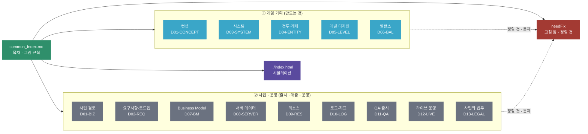

# VR Bowling (BowllyBoll) — 기획서 목차

> 문서 세트: **목차** · 기획: [컨셉](planner_Concept.md) · [시스템](planner_System.md) · [전투·개체](planner_Combat_Entity.md) · [레벨 디자인](designer_LevelDesign.md) · [밸런스](planner_Balance.md) · 사업·운영: [사업 검토](owner_Business.md) · [요구사항·로드맵](planner_Requirements.md) · [Business Model](planner_Monetization.md) · [서버·데이터](developer_Server_Data.md) · [리소스](designer_Resources.md) · [로그·지표](planner_Analytics.md) · [QA·출시](tester_Release.md) · [라이브 운영](operator_LiveOps.md) · [사업화·법무](owner_Legal.md) · [needFix](common_needFix.md)

> **문서 정보**

| 문서 번호 | 버전 | 상태 | 책임자 | 협업 | 최종 수정 | 관련 문서 |
|---|---|---|---|---|---|---|
| `D00-INDEX` | v1.5 | `Review` | 기획자 | — | 2026-11-23 | — |

**변경 이력**

| 버전 | 날짜 | 변경 내용 | 사유 | 결정자 | 영향 범위 |
|---|---|---|---|---|---|

> **분류:** VR 게임 (6DoF 헤드셋, Oculus · Windows MR 설정) · **장르:** 레벨제 아케이드 볼링 + 음악 조명
> **엔진:** Unity 6 (6000.3.26f1) · C# · XR Interaction Toolkit 3.x · URP
> VR 컨트롤러로 공을 잡고 던져 30초 안에 핀을 쓰러뜨리고, 레벨마다 높아지는 목표 점수를 넘기는 볼링 게임.

---

## 문서 구성
- 파일 이름 = `직무 접두사_문서명.md`. 접두사는 해당 문서 **책임자의 직무**를 나타냄 (아래 **직무 접두사** 표). 전 직무 공용 문서(목차 · needFix · 용어집 · 결정 로그)는 `common_`.
- 문서명에는 접두사와 같은 단어를 반복하지 않음 (예: `qa_QA_Release.md` ✗ → `tester_Release.md` ✓).
- 공통 관리: [용어집](common_Glossary.md)(`D00-TERM`) · [결정 로그](common_Decisions.md)(`D00-DEC`) · 이 문서 맨 아래 **단계별 Gate**
- **① 게임 기획** 문서(컨셉 ~ 밸런스)는 **지금 프로젝트에 구현된 내용**(코드 · 씬 · 프리팹 · 데이터)과 그 값으로 계산한 것만 담음. 단, 컨셉의 **기획 의도**는 기획자가 정한 방향임.
- **② 사업 · 운영** 문서는 출시 · 매출 · 운영을 위한 **계획(초안)**임. 상태가 `Draft`인 문서는 아직 정해지지 않은 내용이 있고, 정할 것은 needFix에 모여 있음.
- 고쳐야 할 점 · 부족한 점 · 제안 · 정해야 할 항목은 모두 **[needFix](common_needFix.md)**에 있음.

**문서 규칙** (모든 문서 공통)

| 규칙 | 내용 |
|---|---|
| 문서 정보 | 맨 위 표: 문서 번호 · 버전 · 상태 · 책임자 · 협업 · 최종 수정일 · 관련 문서(링크) |
| 문서 번호 | `D` + 문서 순서 + 이름 (예: `D08-SERVER` = 8번 서버 · 데이터 문서). 번호 ↔ 파일은 아래 표에서 찾음 |
| 버전 | v1.0 = 첫 정식판, 내용을 고칠 때마다 v1.1 · v1.2 … |
| 책임자 | 문서 내용의 정확성 · 최신화 · 승인 요청을 책임지는 **직무 1개**. 파일 접두사와 일치 필요 |
| 협업 | 작성 · 검토에 참여하는 직무 (복수 가능). 최종 책임은 지지 않음 |

**직무 접두사 · 담당 표기 기준**

| 접두사 | 직무 (담당 표기) | 책임 범위 |
|---|---|---|
| `owner_` | 대표 | 사업 방향 · 예산 · 법무 · 최종 승인 |
| `planner_` | 기획자 · 밸런스 기획자 | 게임 규칙 · 시스템 · 수치 · 수익 모델 · 지표 설계 |
| `designer_` | 레벨 디자이너 · 아트 디자이너 · 사운드 디자이너 | 맵 배치 · 그래픽 · 사운드 리소스 |
| `developer_` | 클라이언트 개발자 · 서버 개발자 | 구현 · 데이터 저장 · 외부 연동 |
| `tester_` | QA 테스터 | 테스트 케이스 · 출시 품질 판정 |
| `operator_` | 운영 매니저 | 공지 · 이벤트 · 고객 대응 · 라이브 지표 |
| `common_` | (책임자: 기획자) | 전 직무 공용 관리 문서 |

**번호 찾는 곳**

| 번호 모양 | 뜻 | 정해진 문서 |
|---|---|---|
| `REQ_###` | 요구사항 (할 일) | [planner_Requirements.md](planner_Requirements.md) |
| `S-##` | 고칠 점 · 제안 (게임 기존 목록) | [common_needFix.md](common_needFix.md) |
| `F-##` | 정할 것 | [common_needFix.md](common_needFix.md) |
| `N-##` | 문서 표준화 · 실제 구조 대조 보완 | [common_needFix.md](common_needFix.md) §9 |
| `TC_###` | 테스트 케이스 | [tester_Release.md](tester_Release.md) |
| `PRD_…` · `PLAN_…` · `AD_…` | 상품 · 요금제 · 광고 자리 | [planner_Monetization.md](planner_Monetization.md) |
| `evt_…` | 로그 이벤트 | [planner_Analytics.md](planner_Analytics.md) |
| `MDL_…` · `SFX_…` · `FONT_…` 등 | 리소스 (그림 · 소리 · 폰트) | [designer_Resources.md](designer_Resources.md) |
| 상태 | `Draft`(작성 중) → `Review`(검토 중) → `Confirmed`(구현 대상) → `Deprecated`(폐기). **Confirmed만 구현함** |
| 변경 이력 | 문서 정보 바로 아래. 무엇이 · 왜 · 어디에 영향이 가는지 |
| ID | 한 번 정하면 바꾸지 않음. 코드 · JSON · 로그 · 스토어 상품이 같은 ID를 씀 |
| 데이터 | 원본은 **JSON** (`Balance/`). 수치의 의도 · 근거는 밸런스 문서에 |

**[구성도] 문서 지도**

| 문서 | 문서 번호 | 단계 | 상태 | 책임자 | 협업 |
|---|---|---|---|---|---|
| [컨셉](planner_Concept.md) | `D01-CONCEPT` | P0 | `Review` | 기획자 | — |
| [시스템](planner_System.md) | `D03-SYSTEM` | P1 | `Review` | 기획자 | 클라이언트 개발자 |
| [전투·개체](planner_Combat_Entity.md) | `D04-ENTITY` | P1 | `Review` | 기획자 | 아트 디자이너 |
| [레벨 디자인](designer_LevelDesign.md) | `D05-LEVEL` | P2 | `Review` | 레벨 디자이너 | 밸런스 기획자 |
| [밸런스](planner_Balance.md) | `D06-BAL` | P1 ~ P4 | `Review` | 밸런스 기획자 | — |
| [사업 검토](owner_Business.md) | `D01-BIZ` | P0 | `Draft` | 대표 | 기획자 |
| [요구사항·로드맵](planner_Requirements.md) | `D02-REQ` | P1 ~ | `Draft` | 기획자 | 클라이언트 개발자 (공수 산정) |
| [Business Model](planner_Monetization.md) | `D07-BM` | P1 | `Draft` | 기획자 | 대표 (승인) |
| [서버·데이터](developer_Server_Data.md) | `D08-SERVER` | P1 | `Draft` | 서버 개발자 | 클라이언트 개발자 |
| [리소스](designer_Resources.md) | `D09-RES` | P2 | `Draft` | 아트 디자이너 | 사운드 디자이너 |
| [로그·지표](planner_Analytics.md) | `D10-LOG` | P2 | `Draft` | 기획자 | 클라이언트 개발자 |
| [QA·출시](tester_Release.md) | `D11-QA` | P2 ~ P3 | `Draft` | QA 테스터 | 클라이언트 개발자 |
| [라이브 운영](operator_LiveOps.md) | `D12-LIVE` | P3 ~ P4 | `Draft` | 운영 매니저 | 기획자 |
| [사업화·법무](owner_Legal.md) | `D13-LEGAL` | P0 ~ P3 | `Draft` | 대표 | — |
| [needFix](common_needFix.md) | `D00-FIX` | — | `Review` | 기획자 | 전 직무 (항목별 담당 칸 참고) |
| [시뮬레이션](../index.html) | — | — | — | 클라이언트 개발자 | 전 직무 (열람) |

**단계별 문서 지도**

| 단계 | 목표 | 문서 | 다음 단계로 가는 조건 |
|---|---|---|---|
| P0 사업 검토 | 만들 가치가 있는지 | 컨셉 · 사업 검토 | 타깃 · 핵심 재미 · 수익 구조 · 일정 승인 |
| P1 설계 | 무엇을 어떻게 만들지 확정 | 요구사항 · 시스템 · 전투 · 밸런스 · Business Model · 서버 | MVP 범위 확정, 핵심 문서 `Confirmed` |
| P2 개발 | 알파 → 베타 | 레벨 디자인 · 리소스 · 로그 | 모든 Must 구현, 치명 버그 0 |
| P3 출시 준비 | 스토어 출시 가능 | QA · 출시 · 사업화 · 법무 | 등급분류 · 심사 · 법적 고지 완료 |
| P4 라이브 운영 | 유지 · 성장 | 라이브 운영 | 업데이트마다 변경 이력 · 지표 리뷰 |

> 지금 위치: **P2 개발 — 잡고 던지기 · 레벨 목표 · 음악 조명은 동작, 저작권 곡 교체 · 기록 저장 · 출시 준비는 아직 없음**

---

## 그림 규칙
이 폴더의 모든 그림은 아래 규칙을 따름. 그림 위의 `[종류]`를 보면 무엇을 설명하는 그림인지 바로 알 수 있음.

| 그림 | 답하는 질문 | 모양 |
|---|---|---|
| **[흐름도]** | 어떤 **순서**로 일어나나? | 위 → 아래, 색깔 도형 |
| **[구성도]** | 무엇이 무엇과 **연결**되나? 어떤 요소가 어떤 요소에 **신호를 보내나**? | 왼쪽 → 오른쪽 상자, 화살표에 이름 |
| **[구성도] 예외 처리 지도** | 이런 상황이면 **어떻게 되나**? | 주황 상황 → 초록 ✅ 처리됨 / 빨강 ⚠️ 문제 / 회색 💡 개선 |
| **[와이어프레임]** | 화면 **어디에 무엇이** 있나? | 글자 그림 + 위치 표 (씬 RectTransform 값) |
| **[도면]** | 공간에서 **무엇이 어디에** 있나? | 위에서 본 글자 그림 + 좌표 표 (씬 값) |
| **[상태도]** | 지금 어떤 **상태**이고 언제 **바뀌나**? (화면 전환 포함) | 상태 상자, 바뀌는 조건 화살표 |
| **[막대그래프]** | 숫자가 **얼마나** 다른가? | 막대 한 종류 |
| **[원그래프]** | 전체 중 **몇 %**인가? | 원 조각 |
| **[마인드맵]** | 핵심을 **한눈에** | 가운데 → 가지 |
| **[타임라인]** | **언제 · 얼마 동안** 일어나나? | 왼쪽 → 오른쪽 시간 막대 · 마름모 |
| **[선그래프]** | 시간에 따라 값이 **어떻게 변하나**? (궤적 · 누적) | 선 하나 |
| 글자 그림 (코드 블록) | **위치 · 모양** (옆 · 위에서 본 모습, 궤적, 시간 막대) | 글자 · 기호 |
| 표 | 정확한 숫자, **현재 vs 제안** 비교 | 표 |

**흐름도 색**

| 색 · 모양 | 뜻 |
|---|---|
| 초록 둥근 상자 | 시작 · 입력 |
| 파랑 상자 | 처리 |
| 빨강 상자 | 값 변경 (점수 · 횟수 · 상태) |
| 주황 마름모 | 판단 (Y 예 / N 아니오) |
| 보라 평행사변형 | 출력 (소리 · 화면 · 팝업) |
| 회색 둥근 상자 | 끝 · 무시 |

**상태도 색**

| 색 | 뜻 |
|---|---|
| 초록 | 진행 중 (플레이 · 이동 · 추격) |
| 파랑 | 대기 · 준비 (시작 화면 · 로비 · 탐색) |
| 빨강 | 실패 · 게임오버 · 사망 · 탄창 빔 |
| 회색 | 멈춤 (일시정지 · 정지) |
| 보라 | 결과 · 클리어 |

**세부 조건 (코드 기준)** 은 시스템 문서 끝 **부록 A**에 모여 있음. 본문 흐름도 아래의 링크로 바로 갈 수 있음.

**아이콘** — 상자 앞 아이콘만 봐도 종류를 알 수 있음.

| 흐름도 | 뜻 | 구성도 | 뜻 |
|---|---|---|---|
| ▶ | 시작 · 입력 | 🎬 | 씬 · 입력 |
| ⚙️ | 처리 | 📜 | 스크립트 (코드) |
| ✏️ | 값 변경 | 📦 | 게임 오브젝트 |
| 📢 | 출력 (소리 · 화면) | 🖥️ | 화면 · 소리 |
| ⏹ | 끝 · 무시 | 💾 | 데이터 · 저장 |

구성도는 ① 입력 · 씬 → ② 게임 로직 → ③ 게임 오브젝트 → ④ 화면 · 소리 → ⑤ 데이터 · 저장 **칸(층)**으로 묶여 있음.

**구성도 색**

| 색 | 뜻 |
|---|---|
| 초록 | 씬 · 입력 (시작점) |
| 파랑 | 스크립트 (코드) |
| 회색 | 게임 오브젝트 (총알 · 공 · 핀 · 노트 · 고블린 등) |
| 보라 | 화면 · 소리 |
| 빨강 | 데이터 · 저장 |

## 단계별 Gate
> 다음 단계로 넘어가기 전에 모든 항목 ✅ 필요. ❌ · 🔶 항목은 [needFix](common_needFix.md)에서 처리.

| 단계 | 확인 항목 | 현재 |
|---|---|---|
| P0 → P1 사업 검토 통과 | [사업 검토](owner_Business.md) 승인, 예산 · 일정이 자금 범위 안 | ❌ [사업 검토](owner_Business.md) 상태 `Review` |
|  | 수익 모델과 결제 · 유통 경로 방향 결정 | ❌ [F-04](common_needFix.md) |
|  | [사업화·법무](owner_Legal.md) 항목 목록 작성 | ✅ 목록 있음 |
| P1 → P2 설계 확정 | [요구사항](planner_Requirements.md)의 모든 Must에 담당 · 공수 · 완료 기준 | 🔶 공수 있음 · 담당 초안 배정, 완료 기준(Given / When / Then)은 일부 Must만 작성 → [N-02](common_needFix.md#9-문서-표준화-점검) |
|  | 핵심 기획 문서 상태 `Confirmed` | ❌ `Confirmed` 문서 0개 (모두 `Review` · `Draft`) |
|  | 요구사항 ↔ 시스템 ↔ 밸런스 ↔ 리소스 ID 연결 | 🔶 ID 부여, 연결 점검은 [needFix](common_needFix.md) |
|  | 월 인프라 비용이 예산 안 | 확인 필요 |
| P2 → P3 MVP 완료 | 모든 Must 구현 | 🔶 [요구사항](planner_Requirements.md)의 "할 일" |
|  | 라이브 운영(공지 · 이벤트 · 밸런스 수정)을 빌드 없이 처리 | 확인 필요 — [라이브 운영](operator_LiveOps.md) |
|  | 로그 정상 수집 | ❌ [F-08](common_needFix.md) |
|  | 결제 전체 흐름을 테스트 결제로 검증 | ❌ 결제 미도입 · [Business Model](planner_Monetization.md) |
| P3 → 출시 | 치명 버그 0, 보안 점검 통과 | 확인 필요 — [QA·출시](tester_Release.md) |
|  | 이용약관 · 개인정보처리방침 · 사업자 정보 표시 | ❌ 사업자 정보 없음 |
|  | 스토어 심사 통과 (앱인 경우) | 확인 필요 |
|  | [사업화·법무](owner_Legal.md) 전 항목 완료 | ❌ |
|  | 첫 4주 운영 계획 확정 | 🔶 [라이브 운영](operator_LiveOps.md) 초안 |
