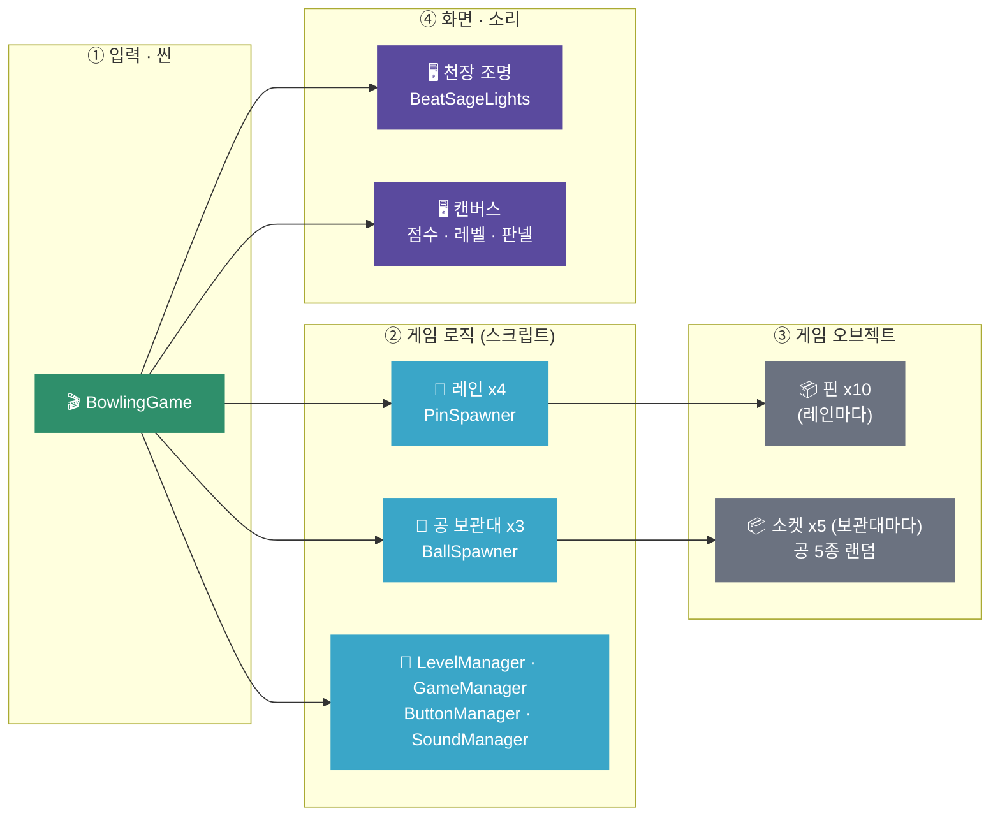
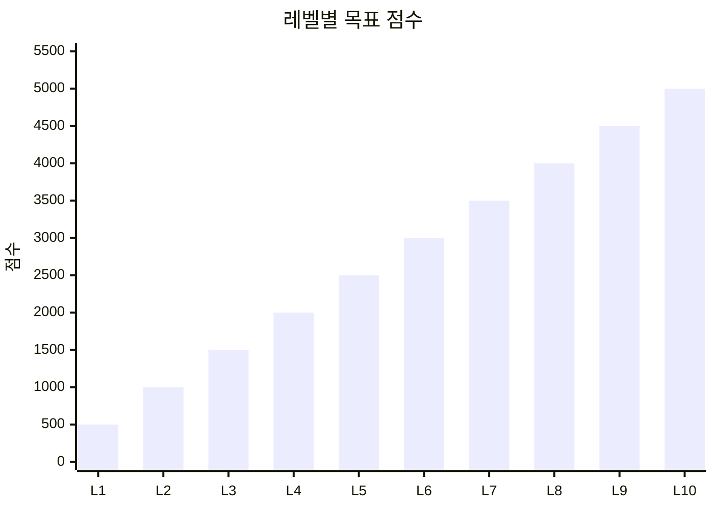

# 레벨 디자인 — 3레인 · 10레벨

> 문서 세트: [목차](common_Index.md) · 기획: [컨셉](planner_Concept.md) · [시스템](planner_System.md) · [전투·개체](planner_Combat_Entity.md) · **레벨 디자인** · [밸런스](planner_Balance.md) · 사업·운영: [사업 검토](owner_Business.md) · [요구사항·로드맵](planner_Requirements.md) · [Business Model](planner_Monetization.md) · [서버·데이터](developer_Server_Data.md) · [리소스](designer_Resources.md) · [로그·지표](planner_Analytics.md) · [QA·출시](tester_Release.md) · [라이브 운영](operator_LiveOps.md) · [사업화·법무](owner_Legal.md) · [needFix](common_needFix.md)
> 데이터: [`Balance/level_goal.json`](planner_Balance/level_goal.json)

> **문서 정보**

| 문서 번호 | 버전 | 상태 | 책임자 | 협업 | 최종 수정 | 관련 문서 |
|---|---|---|---|---|---|---|
| `D05-LEVEL` | v1.1 | `Review` | 레벨 디자이너 | 밸런스 기획자 | 2026-11-23 | [밸런스](planner_Balance.md) |

**변경 이력**

| 버전 | 날짜 | 변경 내용 | 사유 | 결정자 | 영향 범위 |
|---|---|---|---|---|---|

---

## 1. 구성
| 항목 | 내용 | 근거 |
|---|---|---|
| 씬 | `BowlingGame` | 빌드 설정 |
| 레인 | 3개 × 핀 10개 | `PinSpawner` 4개 중 3개 켜짐 (`핀 (3)` 꺼짐) |
| 공 보관대 | 3개 × 소켓 5칸 | `BallSpawner` 3개 |
| 목표 | 레벨마다 목표 점수를 넘겨 10레벨 클리어 | `LevelManager` |

```
   lane 1      lane 2      lane 3
  7 8 9 10    7 8 9 10    7 8 9 10
   4 5 6       4 5 6       4 5 6
    2 3         2 3         2 3
     1           1           1

어느 레인을 쳐도 판정은 같고, 판정 후 3세트 모두 다시 세움
```
> 실제 레인 · 보관대 배치는 씬 캡처 첨부 필요 (담당: 레벨 디자이너) → [S-08](common_needFix.md)

**[구성도] BowlingGame 씬 구성**


**[도면] BowlingGame 씬 — 공 보관대 · 핀 세트 (위에서 본 모습)**
```
z 4.5
  ........................................................
  ......p.............p..............p.............x......
  ........................................................
  ........................................................
  ........................................................
  ........................................................
  ........................................................
  ........................................................
  ........................................................
  ........................................................
  ........................................................
  ........................................................
  ........................................................
  ........................................................
  ..............s.............s..............s............
  ........................................................
  ............................A...........................
  ........................................................
z -20.4   x 22.5 ~ 31.9  (오른쪽 = +x, 위 = +z)
```

| 표시 | 무엇 | 씬 이름 | 월드 좌표 (x, z) |
|---|---|---|---|
| s | 공 보관대 1 | `소켓 (1)` | 24.9, -16.7 |
| s | 공 보관대 2 | `소켓` | 27.3, -16.7 |
| s | 공 보관대 3 | `소켓 (2)` | 29.8, -16.7 |
| p | 핀 세트 1 | `핀` | 23.5, 2.4 |
| p | 핀 세트 2 | `핀 (1)` | 26, 2.4 |
| p | 핀 세트 3 | `핀 (2)` | 28.5, 2.4 |
| x | 핀 세트 — **씬에서 꺼져 있음** | `핀 (3)` | 30.9, 2.4 |
| A | `Steps Area` (보관대 바로 뒤) | `Steps Area` | 27.3, -18.3 |

보관대 줄(z -16.7)에서 핀 줄(z 2.4)까지 약 **19.1m**, 레인 간격은 약 **2.5m**임. 핀 세트 4개 중 `핀 (3)`이 꺼져 있고 코드(`FindObjectsByType`)는 켜진 것만 찾으므로, 지금 씬에서는 **레인 3개**로 동작함. 플레이어(XR Origin) 시작 위치와 메뉴 패널 위치는 씬 캡처로 확인이 필요함.

## 2. 레벨별 목표 (`목표 = 레벨 × 500`, 핀 1개 = 100점, 최대 4투구)
| 레벨 | 1 | 2 | 3 | 4 | 5 | 6 | 7 | 8 | 9 | 10 |
|---|---|---|---|---|---|---|---|---|---|---|
| 목표 | 500 | 1,000 | 1,500 | 2,000 | 2,500 | 3,000 | 3,500 | 4,000 | 4,500 | 5,000 |
| 필요 핀 | 5 | 10 | 15 | 20 | 25 | 30 | 35 | 40 | 45 | 50 |
| 투구당 평균 필요 (4투구) | 1.3 | 2.5 | 3.8 | 5.0 | 6.3 | 7.5 | 8.8 | 10.0 | 11.3 | 12.5 |
| 공 하나로 한 레인씩 | O | O | O | O | O | O | O | O (4투구 모두 10핀) | X | X |

> 9 · 10레벨 목표 조정은 [S-04](common_needFix.md)

**[막대그래프] 레벨별 목표 점수**


## 3. 음악 · 조명
| 항목 | 내용 | 근거 |
|---|---|---|
| 노래 선택 | 로비에서 목록 선택, 켜기 / 끄기 | `SongListUI`, `SoundManager` |
| 천장 조명 | Beat Sage 맵 시간대로 깜빡임 (게임 규칙과는 연결 안 됨) | `BeatSageLights` |
