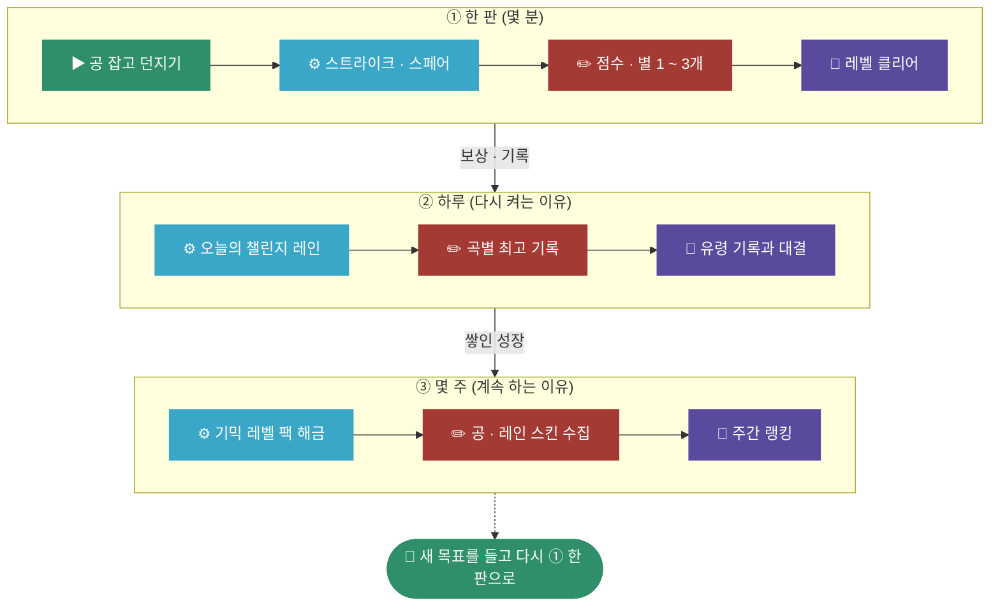

# needFix — 고칠 점 · 부족한 점 · 제안

> 문서 세트: [목차](Proposal.md) · 기획: [컨셉](기획/Concept.md) · [시스템](기획/System.md) · [전투·개체](기획/Combat_Entity.md) · [레벨 디자인](기획/LevelDesign.md) · [밸런스](기획/Balance.md) · 사업·운영: [사업 검토](대표/Business.md) · [요구사항·로드맵](기획/Requirements.md) · [Business Model](기획/Monetization.md) · [서버·데이터](개발/Server_Data.md) · [리소스](디자인/Resources.md) · [로그·지표](기획/Analytics.md) · [QA·출시](QA/QA_Release.md) · [라이브 운영](운영/LiveOps.md) · [사업화·법무](대표/Business_Legal.md) · **needFix**
> 컨셉 ~ 밸런스 문서는 현재 구현만 담고, 바꾸자는 내용은 모두 여기에 모았어요. 반영하면 상태를 **완료**로 바꾸고 컨셉 ~ 밸런스 문서의 값을 고쳐 주세요. 사업 · 운영 문서(계획 · 초안)에서 나온 **정할 것**은 8절에 있어요.

> **문서 정보** · 문서 번호 `D00-FIX` · 버전 v1.2 · 상태 `Review` · 담당 기획자 · 최종 수정 2026-11-21

**변경 이력**

| 버전 | 날짜 | 변경 내용 | 사유 | 결정자 | 영향 범위 |
|---|---|---|---|---|---|
| v0.9 | 2026-11-20 | 기존 문서 (자세한 기록은 git 커밋) | — | 기획자 | — |
| v1.0 | 2026-11-21 | 문서 정보 · 변경 이력 · 문서 번호 추가, 사업 · 운영 문서와 연결, Suggestions에서 이름 변경 | — | 기획자 | 문서만 |
| v1.1 | 2026-11-21 | 기업용 기획 가이드에 있지만 아직 적용 안 된 항목(결정 로그 · 용어집) 추가 | 가이드 흐름과 비교 | 기획자 | 문서만 |
| v1.2 | 2026-11-21 | 공통 관리 항목 반영 (용어집 · 결정 로그 작성, 단계별 Gate 작성 · 미통과 표시) | 기업용 기획 가이드 흐름 | 기획자 | 문서만 |

---

## 1. 버그 · 코드와 의도가 다른 부분
| ID | 현재 (코드 근거) | 문제 | 제안 | 관련 | 상태 |
|---|---|---|---|---|---|
| S-01 | 판정 중에도 0.5초마다 새 공 생성, 던진 공은 대기 투구로 합쳐 판정 | 여러 공으로 쓰러뜨린 핀이 한 번에 합쳐져 투구 수 제한 우회 | 판정 중에는 보관대 소켓 잠금 + "판정 중" 표시 | 시스템 §4 #7 | 대기 |
| S-02 | 30초 초과 시 남은 기회와 상관없이 실패 | ONE MORE로 기회가 남아 있어도 끝남 | 기회 -1만 하고 계속 (기회 0일 때만 실패) | 시스템 §4 #9 | 결정 필요 |
| S-03 | 헤드셋을 벗어도 처리 없음 | 타이머가 계속 흐름 | 헤드셋 착용 해제 시 자동 일시정지 | 시스템 §4 #15 | 대기 |

## 2. 밸런스 · 부족한 기능 제안
### S-04 목표 점수 곡선

현재 9 · 10레벨은 공 하나로 클리어 불가 (밸런스 §3).

```
제안 목표(레벨) = 300 + 레벨 × 200
```
| 레벨 | 1 | 2 | 3 | 4 | 5 | 6 | 7 | 8 | 9 | 10 |
|---|---|---|---|---|---|---|---|---|---|---|
| 현재 목표 | 500 | 1,000 | 1,500 | 2,000 | 2,500 | 3,000 | 3,500 | 4,000 | 4,500 | 5,000 |
| 제안 목표 | 500 | 700 | 900 | 1,100 | 1,300 | 1,500 | 1,700 | 1,900 | 2,100 | 2,300 |
| 제안 투구당 필요 핀 | 1.3 | 1.8 | 2.3 | 2.8 | 3.3 | 3.8 | 4.3 | 4.8 | 5.3 | 5.8 |

> 레벨마다 "투구당 0.5핀"씩만 더 요구. 실제로 맞는 기울기인지는 S-10 플레이 테스트로 확인.

### S-05 점수 보너스
| 보너스 | 조건 | 값 |
|---|---|---|
| STRIKE! | 한 레인 10핀을 한 번에 | +500, 기회 소모 없음, 조명 전체 번쩍 |
| SPARE | (레인 리셋 규칙을 바꿀 때) 남은 핀 모두 | +200 |
| ON BEAT! | 노래 박자 ±0.15초 안에 놓음 | 이번 투구 × 1.2 (음악과 규칙 연결) |

### S-06 레벨 기믹 (목표 숫자 대신 "다르게" 어려워지기)
```
(4) moving pins        (5) blocked lane       (10) boss pin
  <-  7 8 9 10 ->         7 8 9 10               7 8 9 10
  <-   4 5 6   ->          4 5 6                  4 5 6
  <-    2 3    ->          #####                   (B)
  <-     1     ->                                   1
```
| 레벨 | 기믹 |
|---|---|
| 4 | 핀 세트가 좌우로 천천히 이동 |
| 5 | 레인 가운데 장애물 |
| 6 | 공 무게 선택 (가벼움 · 무거움) |
| 7 | 조명이 박자에 맞춰 켜질 때만 핀이 보임 |
| 10 | 가운데 큰 보스 핀 |

### S-07 30초 경고
남은 10초부터 숫자 빨강 + 똑딱 소리.

## 3. 확인 · 결정이 필요한 항목
| ID | 내용 | 필요한 것 |
|---|---|---|
| S-08 | 볼링장 공간 배치(레인 · 보관대 · 플레이어 위치) | VR 화면 · 씬 캡처를 컨셉 · 레벨 디자인에 추가 |
| S-09 | 한 줄 소개 · 타깃 유저 · 레퍼런스 게임 | 기획자가 정해서 컨셉에 추가 (README의 "한 줄 소개: 직접 작성" 칸) |
| S-10 | 실제 플레이어의 투구당 평균 핀 수 · 레벨당 시간 | 플레이 테스트로 측정 → S-04 곡선 기준점 |
| S-11 | 핀 세트 4개 중 `핀 (3)`이 씬에서 꺼져 있어 실제 레인은 3개 (공 보관대도 3개, 4번째 카운트다운 글자도 안 보임) | 3레인이 의도라면 `핀 (3)` 삭제, 4레인이 목표라면 `핀 (3)` 켜고 보관대 1개 추가 |

---

## 4. 실무에서 쓸 때 아쉬운 점
위 1 ~ 3절은 게임 내용, 이 절은 **문서를 실무 팀(개발 · 아트 · QA · 사업)과 함께 쓸 때** 부족한 점이에요. **상태** 칸은 반영 여부예요.

| 아쉬운 점 | 왜 문제인가 | 제안 | 상태 |
|---|---|---|---|
| 문서 정보 · 변경 이력이 없음 | 팀원마다 다른 버전을 보고 이야기하게 됨 | 문서 맨 위에 작성자 · 버전 · 날짜 · 변경 내용 표 | ✅ 반영 — 모든 문서 맨 위 문서 정보 · 변경 이력 |
| 기획 의도(왜)가 없음 | 구현 설명서로 읽혀서, 수치를 바꿀 때 판단 기준이 없음 | 각 시스템 첫머리에 "의도 1 ~ 2줄 → 규칙 → 예외" 순서 | ✅ 반영 — [컨셉](기획/Concept.md) 기획 의도 (시스템 첫머리 의도는 문서마다 다시 확인) |
| UI 와이어프레임 · 맵 도면이 없음 | UI · 아트 · 레벨 담당이 위치와 크기를 알 수 없음 | Figma 와이어프레임, 씬 탑다운 캡처에 번호 표시 | ✅ 반영 — 시스템 · 레벨 문서의 [와이어프레임] · [도면] |
| 리소스 목록(ID)이 없음 | 아트 · 사운드 발주와 진행 확인이 어려움 | `FX_` · `SFX_` · `UI_` ID와 담당 · 상태가 있는 표 | ✅ 반영 — [리소스](디자인/Resources.md) (라이선스 확인은 F-03) |
| 예외 처리가 테스트 케이스로 이어지지 않음 | QA가 같은 내용을 다시 정리해야 함 | 예외 처리 표에 "확인 방법 · 기대 결과" 칸 추가 → 그대로 QA 체크리스트 | ✅ 반영 — [QA · 출시](QA/QA_Release.md) §3 테스트 케이스 |
| 확인 · 결정 항목에 담당 · 기한이 없음 | 누가 언제 정하는지 몰라 계속 "대기" | 3절 표에 담당 · 기한 칸 추가 | ✅ 반영 — 8절 표에 담당 · 기한 칸 |
| 데이터 원본 형식 (예전 지적: CSV만 있음) | 기획 문서와 엔진이 다른 값을 볼 수 있음 | **JSON을 원본**으로 (결정됨), 검증 규칙(JSON Schema)으로 범위 검사 | ✅ JSON 전환 완료 · 검증 규칙은 F-04 |
| 성공 기준(KPI)이 없음 | 고친 뒤 좋아졌는지 판단할 숫자가 없음 | 한 판 평균 시간 · 재시작률 · D1 / D7 재접속률 목표를 먼저 정하기 | ✅ 반영 — [사업 검토](대표/Business.md) §4 · [로그](기획/Analytics.md) (목표값은 가정) |
| VR 편의 · 안전 기준이 없음 | 헤드셋 해제 처리 없음 (S-03), 플레이 공간 · 키 차이 미고려 | 앉아서 / 서서 플레이, 최소 공간, 멀미 · 휴식 안내를 정하기 | ✅ 반영 — [QA · 출시](QA/QA_Release.md) §4 VR 편의 · 안전 기준 (수치 확정은 F-09) |
| 결정 로그 (가이드 0-5) 없음 | 결정 이유가 흩어져 사라짐 | 결정 로그 문서 | ✅ 반영 — [결정 로그](Decisions.md) |
| 용어집 (가이드 0-6) 없음 | 같은 것을 다른 말로 부름 | 용어집 문서 | ✅ 반영 — [용어집](Glossary.md) |
| 단계별 Gate 체크리스트 (P0 → 출시) | 사업 검토에 P0 → P1만 있었음 | 전체 단계 Gate | ✅ 작성 — [목차](Proposal.md) 맨 아래 · ❌ P0 → P1부터 미통과 |

## 5. 기획 · 흐름 평가와 방향

**잘된 점**

- 손으로 잡고 휘둘러 던지는 **VR다운 조작**이에요.
- ONE MORE(1개라도 쓰러뜨리면 기회 +1)가 실패를 부드럽게 해 줘요.
- 노래에 맞춰 깜빡이는 조명이 분위기를 만들어요.

**아쉬운 점** (근거 = 이 문서 세트의 수치)

| 아쉬운 점 | 근거 | 플레이어가 느끼는 것 |
|---|---|---|
| 9 · 10레벨은 클리어할 수 없음 | 목표 4,500 · 5,000 > 공 하나 최대 4,000 (밸런스 §3, S-04) | 끝에서 막혀 "버그 같다"고 느낌 |
| 레인 3개가 같은 역할 | 어느 레인을 쳐도 판정 같음 (레벨 디자인 §1) | 고르는 재미가 없음 |
| 볼링 규칙(스트라이크 · 스페어)이 없음 | 핀 1개 = 100점만 (S-05) | 볼링의 대표 쾌감인 스트라이크가 특별하지 않음 |
| 30초가 지나면 바로 실패 | 남은 기회와 상관없이 실패 (S-02) | 억울함 · VR에서 공 줍는 시간 부족 |

**한 판 흐름 평가**

- 로비 → 레벨 → 결과 → 다음 레벨 흐름이 분명해요.
- 실패 이유가 "점수 부족"과 "시간 초과" 두 가지라서, 결과 화면에서 어느 쪽인지 분명히 보여 주면 다시 도전할 마음이 생겨요.
- 레벨이 오를수록 목표 숫자만 커져서, **다르게 어려워지는** 기믹(S-06)이 필요해요.

**방향 제시** — 우선순위 순서

| 순서 | 방향 | 관련 제안 |
|---|---|---|
| 1 | 목표 점수 곡선을 클리어 가능하게 | S-04 |
| 2 | 스트라이크 · 스페어 보너스 | S-05 |
| 3 | 레벨마다 기믹 (움직이는 핀 · 막힌 레인 · 보스 핀) | S-06 |
| 4 | 30초 경고 · 시간 초과 규칙 완화 | S-07 · S-02 |

## 6. 계속 플레이하게 만드는 성장 설계 (제안)
랭킹 저장(PlayerPrefs 10줄)은 이미 있어요. 여기에 **곡 · 레벨별 기록**과 **수집**을 더하면 VR을 다시 켤 이유가 생겨요.

**[구성도] 재방문 루프 (제안)**


| 단계 | 장치 | 플레이어에게 주는 이유 | 만드는 데 필요한 것 |
|---|---|---|---|
| ① 한 판 | 스트라이크 연출 · 레벨별 별 1 ~ 3개 | 잘 던진 한 투구가 특별해짐 | S-05 · 별 기준 표 |
| ② 하루 | 오늘의 챌린지 (막힌 레인 · 움직이는 핀), 내 최고 기록 유령과 대결 | 짧게 켜도 할 일이 있음 | S-06 · 기록 저장 |
| ③ 몇 주 | 별을 모아 기믹 레벨 팩 · 공 스킨 해금 | 수집 · 새 레벨 | 해금 표 · 스킨 리소스 |
| ③ 몇 주 | 곡별 주간 랭킹 | 같은 곡으로 경쟁 | 서버 또는 플랫폼 리더보드 |

**확인할 숫자 (KPI)**

- 레벨별 클리어율 (어디서 막히는지)
- 투구당 평균 핀 수 · 레벨당 시간 (S-10)
- 세션 길이 (VR 피로 기준 15 ~ 20분 안) · D7 재접속률

## 7. 최종 방향 · 실행 계획
> 위 1 ~ 6절을 바탕으로, 이 게임이 가장 잘될 방향과 무엇부터 할지 정리한 최종 계획이에요.

**최종 방향**
**볼링 규칙을 몰라도 휘두르는 손맛만으로 레벨 목표를 깨는 10레벨 VR 입문용 캐주얼 볼링**. 던지는 쾌감 → 핀이 쓰러지는 소리 · 연출 → 다음 레벨 돌파라는 단순한 성취가 중심이에요.

**정리된 결정**

| 항목 | 위 절의 내용 | 최종 결정 | 이유 |
|---|---|---|---|
| S-04 목표 점수 곡선 | 300 + 레벨 × 200 | 방향은 유지하되 **검증 전 가설**로 두고, 투구당 평균 핀 수(S-10) 측정 후 확정 | 실제 투구 결과와 맞춘 검증 전까지는 근거가 약해요 |
| S-05 보너스 | 스트라이크 · 스페어 + ON BEAT!(박자 ±0.15초, × 1.2) | **스트라이크 · 스페어만**, ON BEAT!는 빼기 | 볼링과 리듬 규칙이 섞이면 입문자가 헷갈려요 |
| S-06 레벨 기믹 | 5종 (움직이는 핀 · 막힌 레인 · 보스 핀 등) | **1 ~ 2종만** 골라 후반 레벨 변주 | 1인 단기 VR 개발에서는 적게 넣고 완성도를 높이는 편이 나아요 |
| 6절 리텐션 | 기믹 레벨 팩 · 공 스킨 · 곡별 주간 랭킹 | **레벨별 별 1 ~ 3개 + 결과 화면에 실패 이유(점수 부족 / 시간 초과)**만 | VR 입문작에 해금 · 랭킹은 무거워요 |

**추가 제안**

| ID | 내용 | 근거 |
|---|---|---|
| S-12 | 던지기 손맛: 스윙 속도 · 놓는 순간이 공의 힘 · 방향으로 이어지는 정도, 공 무게감 조정 | 공이 너무 가볍거나 엉뚱하게 휘면 입문자가 "조종이 안 된다"고 느껴요 |
| S-13 | 기회 규칙 한 표: 기회 · ONE MORE · 핀 다시 세우기 · (S-05 반영 시) 스트라이크 · 스페어가 어떻게 엮이는지 | 규칙이 여러 문서에 흩어져 있어요 |
| S-14 | VR 거리감 기준: 레인 길이(보관대 → 핀 약 19.1m) · 핀 크기 · 서는 위치를 플레이 테스트로 확정 | 거리감은 VR 체감 난이도를 크게 바꿔요 (레벨 디자인 §1 도면) |

**실행 우선순위** (1인 개발 · 짧은 기간)

| 순서 | 할 일 | 관련 제안 |
|---|---|---|
| 1 | 투구 · 판정 버그 정리 (판정 중 연속 투구 · 시간 초과 처리 · 헤드셋 해제 · 꺼진 핀 세트 정리) | S-01 · S-02 · S-03 · S-11 |
| 2 | 클리어 가능한 목표 곡선 + 스트라이크 · 스페어 보너스 | S-04 · S-05(간소화) · S-12 |
| 3 | 후반 레벨 기믹 1 ~ 2종 + 별점 · 실패 이유 결과 화면 | S-06(일부) · S-07 |

## 8. 정할 것
> 정하면 상태를 **완료**로 바꾸고 관련 문서의 `Draft`를 `Review`로 올려 주세요.

| ID | 내용 | 왜 필요한가 | 관련 문서 | 담당 | 기한 | 상태 |
|---|---|---|---|---|---|---|
| F-01 | 1차 VR 스토어 결정 · 빌드 XR 설정 정리 (Oculus · Windows MR 설정 + OpenXR 패키지) | 심사 기준 · 수수료 · 빌드가 달라짐 | [사업 검토](대표/Business.md) | 개발자 | 알파 전 | 대기 |
| F-02 | 경쟁작 3개 선정 · 가격 조사 | 가격 · 차별점 근거 | [사업 검토](대표/Business.md) §3 | 기획자 · 대표 | 알파 전 | 대기 |
| F-03 | **❌ 저작권 곡 `let-it-work`가 `BowlingGame.unity`에서 곡 목록 · 배경음으로 쓰이는 중 → 즉시 교체**, 맑은 고딕 · Jupiter · Yorktown 폰트, Sketchfab 모델 CC 라이선스, 칭찬 음성 출처 확인 | 저작권 침해 · 폰트 재배포 · CC 조건 위반은 출시 차단 사유 | [리소스](디자인/Resources.md) §2 · [사업화 · 법무](대표/Business_Legal.md) | 아티스트 · 대표 | **알파 (가장 먼저)** | ❌ 대기 |
| F-04 | 가격 (₩5,500 ~ ₩9,900) · 무료 데모 여부 | 10레벨 분량에 맞는 가격 | [Business Model](기획/Monetization.md) §3 | 기획자 · 대표 | 출시 준비 전 | 대기 |
| F-05 | 레벨을 JSON으로 추가하는 구조 (레벨 팩 대비) | 업데이트 · DLC가 쉬워짐 | [서버 · 데이터](개발/Server_Data.md) §4 | 개발자 | 베타 | 대기 |
| F-06 | 저장 방식 (JSON 파일 하나) · 저장 항목 확정 | 지금은 아무것도 저장하지 않음 | [서버 · 데이터](개발/Server_Data.md) §3 | 개발자 | 베타 | 대기 |
| F-07 | 안 쓰는 에셋 정리 (`The combat collection STARTER` · `Unity UI Samples` 등) | 빌드 용량 · 라이선스 점검 범위 | [리소스](디자인/Resources.md) | 개발자 | 베타 | 대기 |
| F-08 | 분석 도구 선택 (VR에서 동작하는 것) | [REQ_112](기획/Requirements.md) 시작 조건 | [로그 · 지표](기획/Analytics.md) | 기획자 · 개발자 | 베타 전 | 대기 |
| F-09 | VR 편의 · 안전 기준 수치 확정 (주사율 · 번쩍임 세기 · 앉아서 모드) | 스토어 심사 · 광과민성 · 멀미 | [QA · 출시](QA/QA_Release.md) §4 | QA · 개발자 | 베타 | 대기 |
| F-10 | JSON 검증 규칙(JSON Schema) — `Balance/schema/*.schema.json` | 범위를 벗어난 값을 빌드 전에 잡기 | [밸런스](기획/Balance.md) | 개발자 | 베타 전 | 대기 |
| F-11 | 투구 판정 규칙 확정 (판정 중 두 번째 공을 막을지, 따로 셀지) | [REQ_101](기획/Requirements.md) 완료 기준이 여기에 달려 있음 | [요구사항](기획/Requirements.md) §4 | 기획자 | 알파 | 대기 |
| F-12 | 사업자 형태 · 등록 시점 (다른 게임 · 서비스와 같은 사업자로 갈지) | 스토어 판매자 계정 · 정산 | [사업화 · 법무](대표/Business_Legal.md) | 대표 | 출시 준비 전 | 대기 |
| F-13 | 출시 목표일 | 일정 기준 | [사업 검토](대표/Business.md) §6 | 대표 · 기획자 | 알파 후 | 대기 |
