# 시스템 — 레벨 · 투구 판정 · 공 · 핀 · 랭킹

> 문서 세트: [목차](../Proposal.md) · 기획: [컨셉](Concept.md) · **시스템** · [전투·개체](Combat_Entity.md) · [레벨 디자인](LevelDesign.md) · [밸런스](Balance.md) · 사업·운영: [사업 검토](../대표/Business.md) · [요구사항·로드맵](Requirements.md) · [Business Model](Monetization.md) · [서버·데이터](../개발/Server_Data.md) · [리소스](../디자인/Resources.md) · [로그·지표](Analytics.md) · [QA·출시](../QA/QA_Release.md) · [라이브 운영](../운영/LiveOps.md) · [사업화·법무](../대표/Business_Legal.md) · [needFix](../needFix.md)
> 관련 코드: `LevelManager.cs` · `GameManager.cs` · `ButtonManager.cs` · `Ball.cs` · `BallSpawner.cs` · `Pin.cs` · `PinSpawner.cs` · `Ranking.cs` · `SoundManager.cs`

> **문서 정보** · 문서 번호 `D03-SYSTEM` · 버전 v1.0 · 상태 `Review` · 담당 기획자 · 클라이언트 개발자 · 최종 수정 2026-11-21 · 관련 문서 [전투·개체](Combat_Entity.md) · [Business Model](Monetization.md)

**변경 이력**

| 버전 | 날짜 | 변경 내용 | 사유 | 결정자 | 영향 범위 |
|---|---|---|---|---|---|
| v0.9 | 2026-11-20 | 기존 문서 (자세한 기록은 git 커밋) | — | 기획자 | — |
| v1.0 | 2026-11-21 | 문서 정보 · 변경 이력 · 문서 번호 추가, 사업 · 운영 문서와 연결 | — | 기획자 | 문서만 |

---

## 0. 한눈에 보는 시스템 구조

**[구성도] 스크립트 연결**
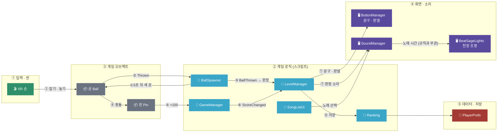

## 1. 화면 흐름
씬은 `BowlingGame` 하나. 로비 · 플레이 · 판넬을 켜고 끄는 방식으로 전환해요 (씬을 다시 불러오지 않아 음악 · 조명이 이어짐).

**[상태도] 화면 전환 (씬 하나 안에서 판넬을 켜고 끔)**
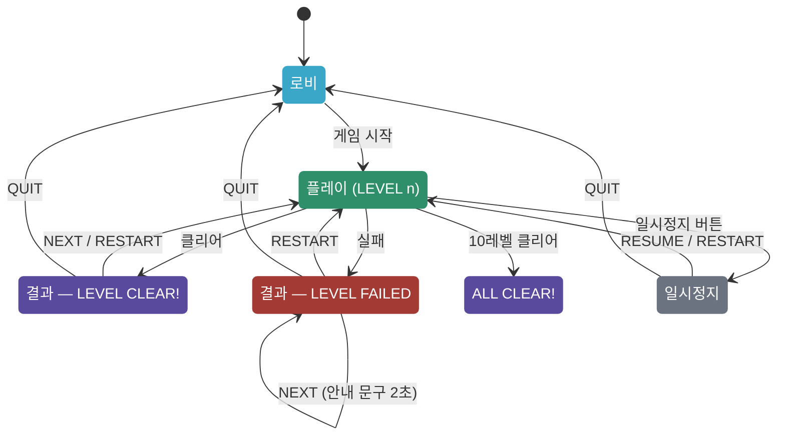

**판넬 구성 (코드에 있는 요소)**
**Result panel**
 - title: LEVEL CLEAR! / LEVEL FAILED / ALL CLEAR!
 - "Score : n"
 - NEXT · RESTART · QUIT
 - 실패 후 NEXT -> "Current score not reached" 2초

**Pause panel**  (열린 동안 timeScale 0)
 - RESUME · RANKING · RESTART · QUIT

**Ranking**
 - 순위 · 레벨 · 점수
 - 점수 높은 순 (같으면 레벨 높은 순)
 - 10줄 보관 · 5줄 표시 · 0점은 저장 안 함

## 2. 레벨 상태 머신 (`LevelManager`)

**[상태도] 레벨 상태 머신 (LevelManager)**
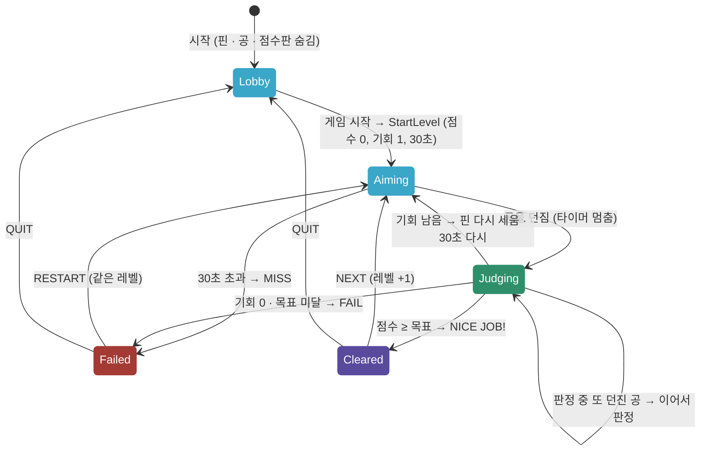

## 3. 작동 로직
### 3-1. 레벨 시작 `StartLevel()`

**[흐름도] 레벨 시작**
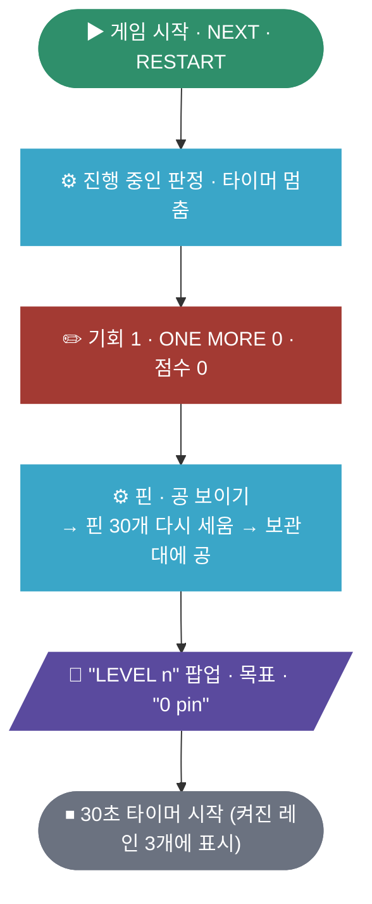

> 세부 조건(코드 기준)은 [부록 A-1](#a-1-레벨-시작-startlevel)에 있어요.

### 3-2. 투구 판정 `JudgeThrow()`

**[흐름도] 공 하나를 던졌을 때**
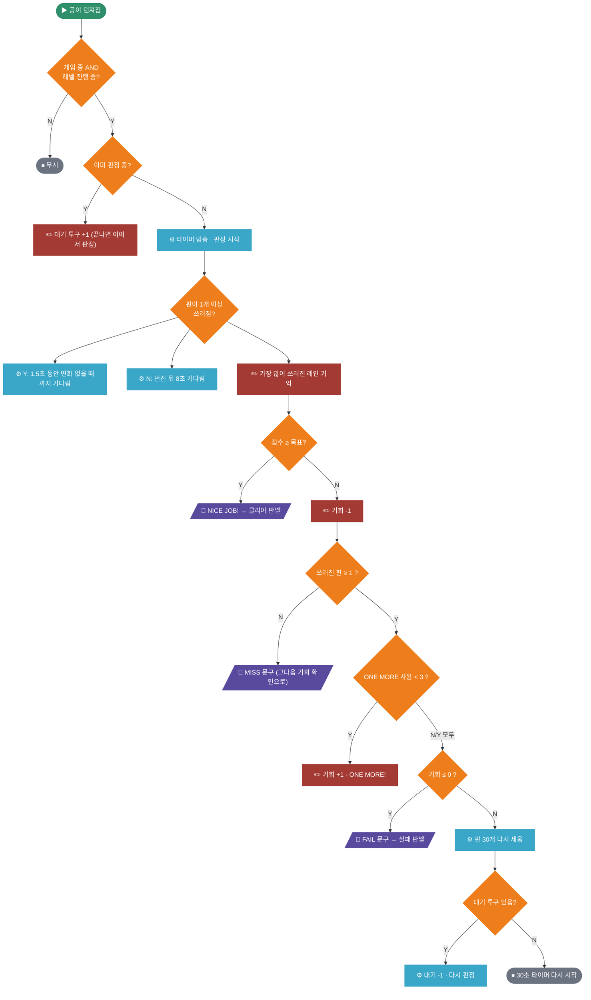

```
case A: 핀이 쓰러짐
  throw --- pins falling --- last change ---[ 1.5s no change ]---> JUDGE

case B: 하나도 안 쓰러짐
  throw ------------------------------------[ 8s ]-------------> MISS

case C: 굴러가는 중에 점수가 목표에 닿음
  throw --- pins falling --- score >= goal ---> JUDGE now -> NICE JOB
```

> 세부 조건(코드 기준)은 [부록 A-2](#a-2-투구-판정-judgethrow)에 있어요.

### 3-3. 공 (`Ball` · `BallSpawner`)

**[흐름도] 공을 놓았을 때 · 회수**
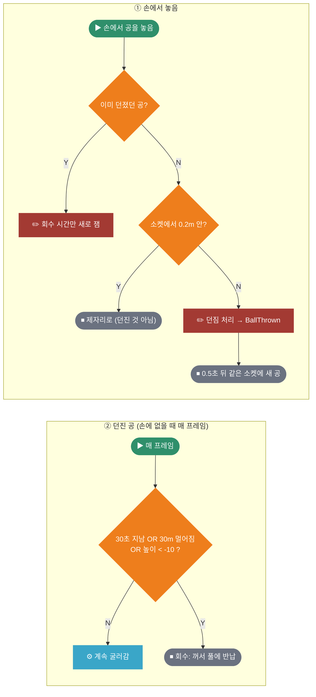

```
(위에서 본 모습, 보관대 1개)
   S1  S2  S3  S4  S5        <- 소켓 5칸 (보관대 3개)
   |<0.2m>|
   O                        <- 소켓에서 0.2m 안에서 놓음 = 제자리 (던진 것 아님)
          O ------>         <- 0.2m 밖에서 놓음 = 던짐 -> 0.5초 뒤 같은 칸에 새 공

회수 조건 (손에 없을 때만 검사)
   놓은 뒤 30초  OR  소켓에서 30m 이상  OR  높이 -10 아래
```

> 세부 조건(코드 기준)은 [부록 A-3](#a-3-공-ball--ballspawner)에 있어요.

### 3-4. 핀 (`Pin`)

**[흐름도] 핀 하나**
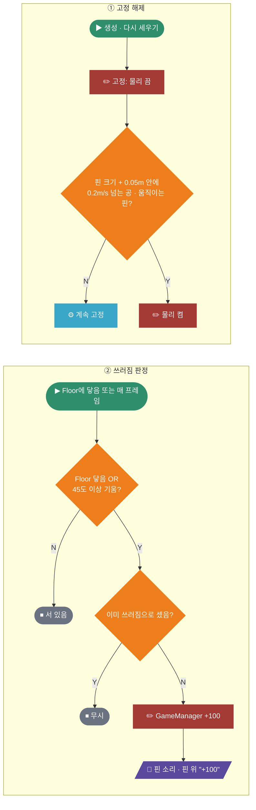

**고정 해제 (공이 오기 전에는 물리를 꺼 둠)**
```
before ball           ball comes (> 0.2 m/s)
  7  8  9  10           7  8  9  10
    4  5  6               4  5  6
      2  3                  2  3
        1                   (1)  <- 핀 크기 + 0.05m 안 -> 물리 켬
                             O
```
**쓰러짐 판정**
```
  (a)        (b)         (c)
   |           /
   |          /          ____
 -----      -----       ------

(a) 서 있음 · (b) 45도 이상 기움 = 쓰러짐 · (c) 바닥(Floor)에 닿음 = 쓰러짐
```

> 세부 조건(코드 기준)은 [부록 A-4](#a-4-핀-pin)에 있어요.

### 3-5. 랭킹 (`Ranking`)

**[흐름도] 랭킹 저장**
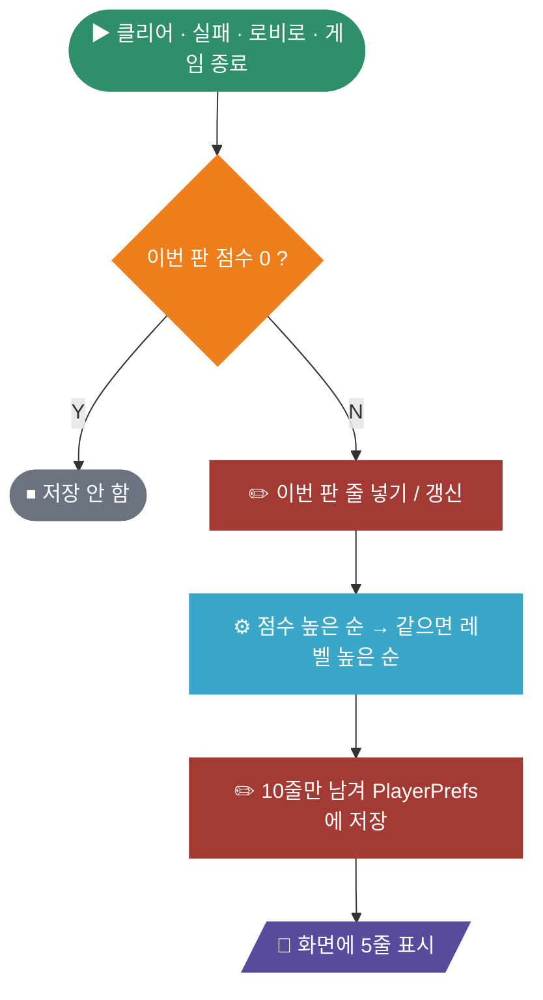

> 세부 조건(코드 기준)은 [부록 A-5](#a-5-랭킹-ranking)에 있어요.

### 3-6. 일시정지

**[흐름도] 일시정지**
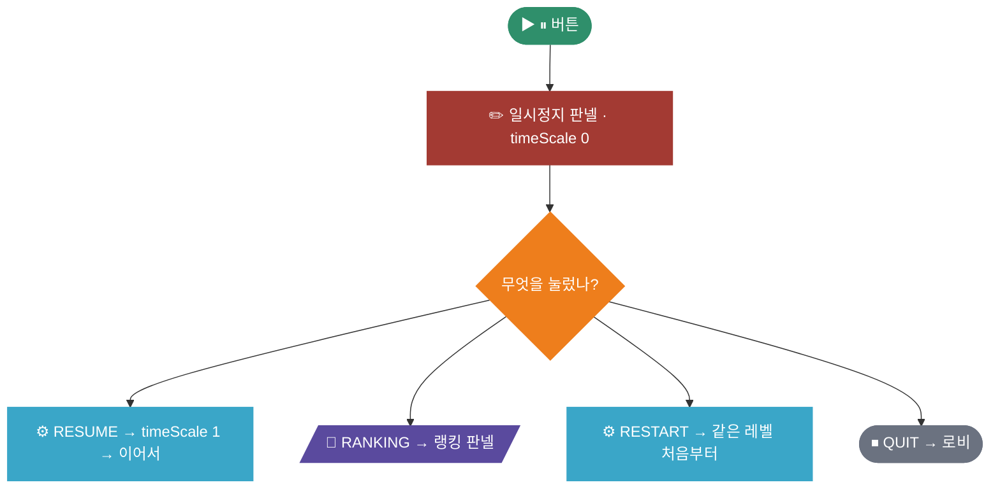

> 세부 조건(코드 기준)은 [부록 A-6](#a-6-일시정지)에 있어요.

## 4. 예외 처리 (Edge Case) — 현재 동작
**[구성도] 예외 처리 지도**
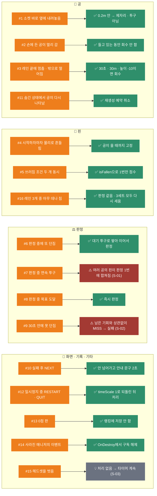

**[타임라인] 판정 중 연속 투구 (예외 #7)**
```mermaid
gantt
  title 판정 중 연속 투구
  dateFormat x
  axisFormat %S.%L초
  section 판정
  판정 진행 중 (예) :active, j1, 0, 2500ms
  section 공
  공 1 던짐 → 판정 시작 :milestone, b1, 0, 0ms
  공 2 던짐 (판정 중) :crit, milestone, b2, 500, 0ms
  공 3 던짐 (판정 중) :crit, milestone, b3, 1000, 0ms
```

| # | 상황 | 현재 동작 | 상태 |
|---|---|---|---|
| 1 | 공을 소켓 바로 옆에 내려놓음 | 0.2m 안이면 제자리 → 던진 것으로 안 셈 | ✅ |
| 2 | 손에 든 공이 멀리 감 | 들고 있는 동안은 회수 안 함 | ✅ |
| 3 | 공이 레인 끝에 멈춤 · 밖으로 떨어짐 | 30초 · 30m · 높이 -10으로 회수 | ✅ |
| 4 | 시작하자마자 핀이 물리로 흔들려 쓰러짐 | 공이 올 때까지 고정 | ✅ |
| 5 | 쓰러짐 조건 두 개를 동시에 만족 | `isFallen`으로 1번만 점수 | ✅ |
| 6 | 판정 중에 또 던진 공 | 대기 투구로 쌓아 이어서 판정 | ✅ |
| 7 | 판정 중 연속 투구 | 0.5초마다 새 공 → 여러 공의 핀이 판정 1번에 합쳐짐 | ⚠️ → [S-01](../needFix.md) |
| 8 | 판정 중 목표 도달 | 즉시 판정 | ✅ |
| 9 | 30초 안에 못 던짐 | 남은 기회와 상관없이 MISS → 실패 판넬 | ⚠️ → [S-02](../needFix.md) |
| 10 | 실패 후 NEXT | 넘어가지 않고 "Current score not reached" 2초 | ✅ |
| 11 | 숨긴 상태에서 공이 다시 나타남 | 숨길 때 재생성 예약 취소 | ✅ |
| 12 | 일시정지 상태에서 RESTART · QUIT | timeScale 1로 되돌린 뒤 처리 | ✅ |
| 13 | 0점 판 | 랭킹에 저장 안 함 | ✅ |
| 14 | 사라진 매니저의 이벤트 | `OnDestroy`에서 구독 해제 | ✅ |
| 15 | 헤드셋을 벗음 | 처리 없음 → 타이머 계속 | → [S-03](../needFix.md) |
| 16 | 레인 3개 중 아무 데나 침 | 판정은 같고, 판정 후 3세트 모두 다시 세움 | ✅ |

---

## 부록 A. 세부 조건 (코드 기준)
본문 흐름도의 조건을 코드 그대로 적은 개발 참고용이에요. 기획 내용은 본문에 있어요.

### A-1. 레벨 시작 `StartLevel()`
```
코루틴 전부 정지 → 판정 · 레벨 종료 플래그 해제 → 대기 중 투구 0
기회 = 1, ONE MORE 사용 = 0, 점수 0
핀 · 공 보이기 → 핀 전부 다시 세우기 (켜진 뒤에 — 순서 중요) → 모든 보관대에 공 새로
"LEVEL n" 팝업 · 목표 글자 갱신 · 핀 개수 "0 pin" → 30초 타이머 시작 (켜진 레인 3개에 표시)
```

### A-2. 투구 판정 `JudgeThrow()`
```
공이 던져짐 (BallThrown)
├─ IF 게임 시작 전 OR 레벨 끝남 → 무시
├─ IF 이미 판정 중 → 대기 투구 +1 (판정이 끝나면 이어서 판정)
└─ ELSE → 판정 시작 (타이머 멈춤)
    ① 대기: 쓰러진 핀 수가 바뀔 때마다 시간 갱신
       ├─ 1개 이상 AND 1.5초 동안 변화 없음 → 결과 확정
       └─ 0개 AND 던진 뒤 8초 경과 → 결과 확정
    ② 가장 많이 쓰러진 레인 기억 (다음 카운트다운은 그 레인에만)
    ③ IF 점수 ≥ 목표 → NICE JOB! → 클리어 (몇 개를 쓰러뜨렸든)
    ④ 기회 -1
       ├─ IF 쓰러진 핀 < 1 → MISS (효과 · 소리)
       ├─ ELSE IF ONE MORE 사용 < 3 → 사용 +1, 기회 +1, ONE MORE! (효과 · 소리)
       └─ ELSE → 문구 없이 진행
    ⑤ IF 기회 ≤ 0 → (MISS가 아니었으면 FAIL 문구) → 실패
       ELSE → 핀 다시 세우기
    ⑥ IF 대기 투구 > 0 → 대기 -1, 다시 판정 / ELSE → 30초 타이머 다시
점수가 목표에 닿았는데 판정 중이 아님 → 즉시 판정
```

### A-3. 공 (`Ball` · `BallSpawner`)
```
보관대 소켓마다 공 생성 (오브젝트 풀, 공 프리팹 5종 중 랜덤)
손으로 잡음 → isHeld (소켓이 잡는 것은 무시)
손에서 놓음
├─ IF 이미 던진 공을 다시 주웠다 놓음 → 회수 시간만 새로 잼
├─ IF 소켓에서 0.2m 안 → 제자리로 되돌림 (던진 것 아님)
└─ ELSE → 던짐 처리 → BallThrown 알림 → 0.5초 뒤 같은 소켓에 새 공
던진 공 (손에 없을 때만 검사)
└─ IF 높이 < -10 OR 소켓에서 30m 이상 OR 놓은 지 30초 → 회수(꺼서 풀에 반납)
바닥(Floor)에 처음 닿음 → 굴러가는 소리 1번
```

### A-4. 핀 (`Pin`)
```
생성 · 다시 세우기 → 고정(물리 끔, kinematic)
고정 중 매 물리 프레임: 주변(핀 크기 + 0.05m)에
  └─ 0.2m/s보다 빠른 공 OR 움직이는 핀 → 고정 해제 (물리 켬)
쓰러짐 (1번만)
  ├─ Floor 태그 트리거에 닿음 OR 처음 방향에서 45도 이상 기울어짐
  └─ 핀 소리 · GameManager +100점 · 핀 위에 "+100" 떠오름
```

### A-5. 랭킹 (`Ranking`)
```
저장 시점: 레벨 클리어 · 실패 · 로비로 나갈 때 · 게임 종료
한 판 = 한 줄 (판 번호 = 시작 시각), 0점은 저장 안 함
정렬: 점수 높은 순 → 같으면 레벨 높은 순, 10줄 보관 · 5줄 표시
저장소: PlayerPrefs에 JSON 문자열
```

### A-6. 일시정지
```
⏸ → 일시정지 판넬 + timeScale 0 (타이머 · 물리 · 판정 대기 모두 멈춤)
RESUME → timeScale 1 / RESTART · QUIT → timeScale 1로 되돌린 뒤 처리
```
