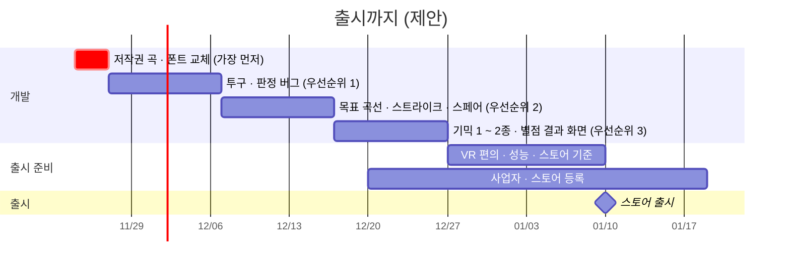

# 사업 검토 — VR Bowling (BowllyBoll)

> 문서 세트: [목차](../Index.md) · 기획: [컨셉](../기획/Concept.md) · [시스템](../기획/System.md) · [전투·개체](../기획/Combat_Entity.md) · [레벨 디자인](../기획/LevelDesign.md) · [밸런스](../기획/Balance.md) · 사업·운영: **사업 검토** · [요구사항·로드맵](../기획/Requirements.md) · [Business Model](../기획/Monetization.md) · [서버·데이터](../개발/Server_Data.md) · [리소스](../디자인/Resources.md) · [로그·지표](../기획/Analytics.md) · [QA·출시](../QA/QA_Release.md) · [라이브 운영](../운영/LiveOps.md) · [사업화·법무](Business_Legal.md) · [needFix](../needFix.md)

> **문서 정보** · 문서 번호 `D01-BIZ` · 버전 v1.0 · 상태 `Draft` · 담당 대표 · 기획자 · 최종 수정 2026-11-21 · 관련 문서 [컨셉](../기획/Concept.md) · [Business Model](../기획/Monetization.md) · [사업화·법무](Business_Legal.md)

**변경 이력**

| 버전 | 날짜 | 변경 내용 | 사유 | 결정자 | 영향 범위 |
|---|---|---|---|---|---|
| v1.0 | 2026-11-21 | 최초 작성 | — | 대표 | — |

---

## 1. 목적
이 게임을 **출시까지 만들 가치가 있는지** 판단하는 문서예요. 사업계획서 · 정부지원사업 신청서의 원본으로도 써요. 숫자는 **목표 · 가정**이에요.

## 2. 한 장 요약
| 항목 | 내용 | 상태 |
|---|---|---|
| 게임 이름 | BowllyBoll (`docs/00_README.md`) | 상표 확인 필요 |
| 한 줄 정의 | 손으로 잡고 휘둘러 던지는 VR 볼링으로, 레벨마다 목표 점수를 넘겨 10레벨을 깨는 게임 | 확정 ([컨셉](../기획/Concept.md)) |
| 최종 방향 | 볼링 규칙을 몰라도 **휘두르는 손맛만으로** 레벨을 깨는 VR 입문용 캐주얼 볼링 | needFix §7 결정 |
| 플랫폼 | 6DoF VR 헤드셋 — `meta-openxr` · `androidxr-openxr` 패키지, 빌드 설정에 Oculus · Windows MR | 1차 스토어 결정 → [F-01](../needFix.md#8-정할-것) |
| 타깃 | 볼링 규칙을 몰라도 바로 즐기는 VR 입문자 | 확정 |
| 수익 모델 | **저가 유료 앱** + 레벨 팩 (출시 후) → [Business Model](../기획/Monetization.md) | 제안 |

## 3. 경쟁작 비교
| 유형 | 보통의 Business Model | 이 게임의 차별점 |
|---|---|---|
| VR 볼링 시뮬레이션 | 유료 앱 · 멀티 | 규칙 대신 **레벨 목표 점수 도전**, 30초 짧은 판 |
| VR 미니게임 모음 | 유료 · 무료 + DLC | 볼링 하나에 집중한 손맛 · 조명 연출 |
| 모션 스포츠 (Wii Sports 류) | 패키지 | VR 1인칭 · 노래에 맞춰 깜빡이는 조명 |

## 4. 목표 지표 (KPI) — 가정
| 지표 | 목표 (예시값) | 확인 방법 |
|---|---|---|
| 레벨 1 클리어율 | 90% | [로그](../기획/Analytics.md) `evt_level_end` |
| 10레벨 완주율 | 30% | 같은 이벤트 |
| 투구당 평균 핀 수 | 측정 후 목표 곡선 확정 ([S-10](../needFix.md)) | `evt_throw` |
| 환불률 | 5% 미만 | 스토어 콘솔 |
| 멀미 · 조작 불만 리뷰 | 5% 미만 | 스토어 리뷰 |

## 5. 개략 예산 (1인 개발)
| 항목 | 내용 |
|---|---|
| 인건비 | 1인 (기획 · 개발 겸임) |
| 기기 | 테스트 헤드셋 |
| **음원 · 폰트 교체** | 저작권 곡(let-it-work) · 맑은 고딕 교체 — 무료(상업 허용) 또는 구매 |
| 스토어 | VR 스토어 등록 · 심사 |
| 서버 | 없음 |

## 6. 개략 일정
**[타임라인] 출시까지 (제안)**

## 7. 리스크와 대응
| 리스크 | 영향 | 대응 |
|---|---|---|
| **"저작권있음 사용x" 곡이 씬에서 쓰이는 중** (곡 목록 · 배경음) | 출시 시 저작권 침해 | 즉시 교체 ([F-03](../needFix.md)) |
| **맑은 고딕 폰트를 게임에 포함** | Microsoft 폰트 재배포 문제 가능 | 상업 허용 한글 폰트로 교체 ([F-03](../needFix.md)) |
| Sketchfab 모델 (공 · 볼링장) | CC 라이선스 조건(표기 · 비상업) 위반 위험 | 모델별 라이선스 확인 ([리소스](../디자인/Resources.md)) |
| 콘텐츠 분량 (10레벨) | 유료 앱 환불 | 가격을 분량에 맞춤 · 별점 재도전 |
| 던지기 손맛 ([S-12](../needFix.md)) | "조종이 안 된다" 리뷰 | 스윙 → 공 힘 · 방향 조정 우선 |

## 8. 결정 (Gate P0 → P1)
- [ ] 1차 스토어 ([F-01](../needFix.md)) · 가격 ([F-04](../needFix.md)) · 출시 목표일 ([F-13](../needFix.md))
